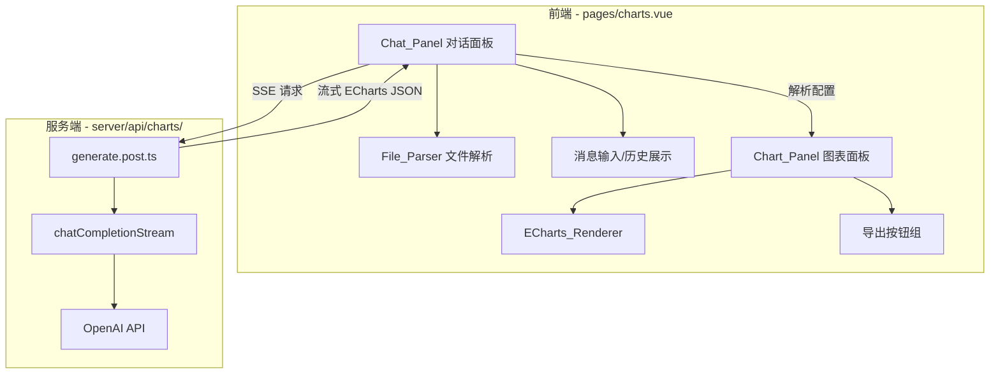

# 技术设计文档：AI 图表可视化

## 概述

本功能将现有的 `/charts` 静态图表页面改造为 AI 驱动的交互式图表可视化工具。用户可上传 Excel/CSV 数据文件，通过自然语言对话让 AI 生成 ECharts 配置，实现数据可视化的智能化。

核心技术选型：
- **前端文件解析**：xlsx（SheetJS）在浏览器端解析 Excel/CSV
- **图表渲染**：ECharts（项目已安装 echarts@5.4.3）
- **LLM 调用**：复用现有 `chatCompletion` 工具函数，扩展支持多轮消息
- **流式响应**：复用现有 SSE 模式（参考 export-summary-stream.post.ts）
- **对话状态**：客户端内存管理，无需持久化

## 架构



**数据流：**
1. 用户上传文件 → File_Parser 在浏览器解析为 JSON 数组
2. 用户输入自然语言描述 → 前端组装消息（含数据样本 + 对话历史）
3. 前端发起 SSE 请求到 `/api/charts/generate`
4. 服务端调用 LLM 流式返回 → 前端实时显示 AI 回复
5. 前端从 AI 回复中提取 ECharts option JSON → 渲染图表

## 组件与接口

### 前端组件

#### 1. `pages/charts.vue`（重构）

页面主容器，管理左右分栏布局。

```typescript
// 页面状态
interface ChartPageState {
  parsedData: Record<string, any>[] | null  // 解析后的数据
  columns: string[]                          // 列名列表
  chartOption: EChartsOption | null          // 当前图表配置
  messages: ChatMessage[]                    // 对话历史
  isLoading: boolean                         // AI 响应加载状态
}
```

#### 2. `components/charts/ChatPanel.vue`

左侧对话面板，包含文件上传、消息列表、输入框。

```typescript
interface Props {
  messages: ChatMessage[]
  isLoading: boolean
  hasData: boolean  // 是否已上传数据
}

interface Emits {
  (e: 'send', message: string): void
  (e: 'fileUploaded', data: ParsedFileResult): void
}
```

#### 3. `components/charts/ChartPanel.vue`

右侧图表面板，包含 ECharts 渲染区域和导出按钮。

```typescript
interface Props {
  option: EChartsOption | null
}

interface Emits {
  (e: 'exportPng'): void
  (e: 'exportJson'): void
}
```

#### 4. `composables/useFileParser.ts`

文件解析 composable，封装 xlsx 库的调用。

```typescript
interface ParsedFileResult {
  columns: string[]
  data: Record<string, any>[]
  totalRows: number
  preview: Record<string, any>[]  // 前5行
}

export function useFileParser() {
  function parseFile(file: File): Promise<ParsedFileResult>
  function getSampleData(data: Record<string, any>[], maxRows?: number): Record<string, any>[]
  return { parseFile, getSampleData }
}
```

#### 5. `composables/useChartChat.ts`

对话与 AI 交互 composable，管理消息历史和 SSE 通信。

```typescript
interface ChatMessage {
  role: 'user' | 'assistant'
  content: string
  chartOption?: EChartsOption  // AI 消息中提取的图表配置
}

export function useChartChat() {
  const messages: Ref<ChatMessage[]>
  const isLoading: Ref<boolean>
  const currentOption: Ref<EChartsOption | null>

  function sendMessage(content: string, data: Record<string, any>[], columns: string[]): Promise<void>
  function extractChartOption(text: string): EChartsOption | null
  function reset(): void

  return { messages, isLoading, currentOption, sendMessage, extractChartOption, reset }
}
```

### 服务端 API

#### `server/api/charts/generate.post.ts`

接收对话消息，调用 LLM 生成 ECharts 配置，SSE 流式返回。

```typescript
// 请求体
interface GenerateRequest {
  messages: { role: 'user' | 'assistant'; content: string }[]
  dataSample: Record<string, any>[]  // 前20行数据
  columns: string[]
  currentOption?: object              // 当前图表配置（用于迭代修改）
}

// SSE 事件
type SSEEvent =
  | { type: 'chunk'; content: string }      // 流式文本片段
  | { type: 'done'; content: string }       // 完整响应
  | { type: 'error'; message: string }      // 错误信息
```

### 工具函数

#### `server/utils/embedding.ts`（扩展）

新增支持多轮消息的流式 chat 函数：

```typescript
export async function chatCompletionStream(
  messages: { role: 'system' | 'user' | 'assistant'; content: string }[],
  options?: { temperature?: number; maxTokens?: number }
): AsyncGenerator<string>
```

## 数据模型

本功能不涉及数据库变更，所有状态在客户端内存中管理。

### 客户端状态模型

```typescript
// 解析后的文件数据
interface ParsedFileResult {
  columns: string[]                    // 列名
  data: Record<string, any>[]          // 完整数据行
  totalRows: number                    // 总行数
  preview: Record<string, any>[]       // 前5行预览
}

// 对话消息
interface ChatMessage {
  role: 'user' | 'assistant'
  content: string                      // 消息文本内容
  chartOption?: EChartsOption          // 从 AI 回复中提取的图表配置（仅 assistant）
  timestamp: number
}

// ECharts 配置（使用 echarts 库自带类型）
type EChartsOption = echarts.EChartsOption
```

### System Prompt 设计

```typescript
const CHART_SYSTEM_PROMPT = `你是一个专业的数据可视化助手。你的任务是根据用户提供的数据和需求，生成 ECharts 图表配置。

规则：
1. 始终返回有效的 ECharts option JSON，包裹在 \`\`\`json 代码块中
2. 根据数据特征和用户需求选择合适的图表类型（折线图、柱状图、饼图、散点图等）
3. 配置中应包含合理的 tooltip、legend、axis 等辅助元素
4. 使用美观的配色方案
5. 确保数据正确映射到图表的各个维度
6. 如果用户要求修改现有图表，基于当前配置进行调整

当前数据列：{columns}
数据样本（前20行）：
{dataSample}
`
```


## 正确性属性

*属性（Property）是指在系统所有有效执行中都应保持为真的特征或行为——本质上是对系统应做什么的形式化陈述。属性是人类可读规范与机器可验证正确性保证之间的桥梁。*

### 属性 1：文件解析产生有效结构化输出

*对于任意*有效的 Excel 或 CSV 文件内容，File_Parser 解析后应产生一个包含 `columns`（非空字符串数组）和 `data`（对象数组，每个对象的键集合等于 columns）的结果。

**验证需求：1.1, 1.2**

### 属性 2：数据摘要正确提取列名和预览行

*对于任意*解析后的数据数组（长度 >= 1），生成的摘要应包含完整的列名列表，且预览数据为前 min(5, totalRows) 行，与原始数据的对应行完全一致。

**验证需求：1.3**

### 属性 3：请求载荷包含完整上下文

*对于任意*用户消息、数据样本、列名列表和对话历史（可能包含当前图表配置），构造的 API 请求载荷应包含所有这些字段，且对话历史中的消息顺序与原始顺序一致。

**验证需求：2.1, 3.2**

### 属性 4：从 Markdown 代码块中提取 ECharts 配置

*对于任意*有效的 JSON 对象，将其包裹在 markdown 代码块（```json ... ```）中后，extractChartOption 函数应能提取并解析出与原始对象等价的结果。

**验证需求：2.2, 6.1**

### 属性 5：数据采样遵守 20 行限制

*对于任意*长度为 N 的数据数组，getSampleData 函数返回的结果长度应为 min(N, 20)，且返回的行应为原始数据的前 min(N, 20) 行。

**验证需求：2.5**

### 属性 6：对话历史保持完整有序

*对于任意*消息序列（交替的 user/assistant 消息），依次添加到对话历史后，历史记录的长度应等于添加的消息数，且每条消息的内容和角色与添加顺序一致。

**验证需求：3.1**

### 属性 7：数据替换完全覆盖旧数据

*对于任意*两组解析后的文件数据 A 和 B，当用 B 替换 A 后，当前数据状态应与 B 完全一致，不包含 A 的任何残留。

**验证需求：3.4**

### 属性 8：ECharts 配置序列化往返一致性

*对于任意*有效的 ECharts option 对象，将其序列化为 JSON 字符串后再解析，应产生与原始对象深度相等的结果。

**验证需求：5.2, 6.2, 6.3, 6.4**

## 错误处理

### 文件解析错误

| 错误场景 | 处理方式 |
|---------|---------|
| 不支持的文件格式 | 显示提示"仅支持 .xlsx、.xls、.csv 格式" |
| 文件内容为空 | 显示提示"文件内容为空，请检查文件" |
| 文件解析异常（损坏） | 捕获异常，显示"文件解析失败，请确认文件未损坏" |
| 文件过大（>10MB） | 前端拦截，提示"文件过大，请控制在 10MB 以内" |

### AI 生成错误

| 错误场景 | 处理方式 |
|---------|---------|
| 网络请求失败 | 显示"网络连接失败，请重试" |
| LLM 返回无法解析的内容 | 显示 AI 原始回复文本，提示"未能生成有效图表配置，请尝试更具体的描述" |
| SSE 连接中断 | 显示已接收的部分内容，提示"连接中断，请重试" |
| 服务端超时 | 30 秒超时，提示"请求超时，请简化描述后重试" |

### ECharts 渲染错误

| 错误场景 | 处理方式 |
|---------|---------|
| 配置格式有效但渲染失败 | 捕获 ECharts 错误，显示"图表渲染失败，请尝试修改描述" |
| 数据与配置不匹配 | 由 LLM 在下一轮对话中修正 |

## 测试策略

### 属性测试（Property-Based Testing）

使用项目已安装的 `fast-check` 库进行属性测试，每个属性测试至少运行 100 次迭代。

测试文件结构：
```
tests/
  charts/
    file-parser.property.test.ts    # 属性 1, 2, 5
    chart-option-extract.property.test.ts  # 属性 4, 8
    chat-context.property.test.ts   # 属性 3, 6, 7
```

每个属性测试必须以注释标注对应的设计属性：
```typescript
// Feature: ai-chart-visualization, Property 4: 从 Markdown 代码块中提取 ECharts 配置
```

配置要求：
- 每个属性测试最少 100 次迭代（`fc.assert(property, { numRuns: 100 })`）
- 使用 fast-check 的 `fc.record`、`fc.array`、`fc.string` 等生成器构造随机输入
- 边界情况（空文件、超大数据、非法格式）通过生成器的边界值覆盖

### 单元测试

单元测试聚焦于具体示例和边界情况：

```
tests/
  charts/
    file-parser.test.ts        # 具体文件解析示例、错误处理
    chart-option-extract.test.ts  # 特定格式的提取示例
    chart-export.test.ts       # 导出功能示例
```

单元测试覆盖：
- 具体的 Excel/CSV 文件解析示例（使用 fixture 文件）
- 错误处理路径（不支持的格式、空文件、损坏文件）
- ECharts 配置提取的边界情况（无代码块、多个代码块、嵌套代码块）
- 导出按钮禁用状态逻辑
- 空状态显示逻辑

### 测试互补关系

- **属性测试**：验证通用规则在所有输入上成立（解析正确性、往返一致性、上下文完整性）
- **单元测试**：验证具体示例和边界情况（特定文件格式、错误提示文案、UI 状态）
- 两者结合提供全面覆盖：属性测试发现意外输入的 bug，单元测试确认具体行为符合预期
