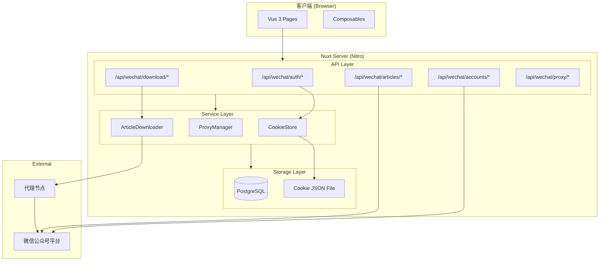

# Design Document: WeChat Integration

## Overview

将 wechat-article-exporter 的核心功能集成到 knowledge-base 项目中，实现微信公众号扫码登录、公众号批量管理、文章列表同步、文章内容下载和代理节点管理。核心变更是将原项目的浏览器端 IndexedDB (Dexie) 存储替换为服务端 PostgreSQL 存储，同时将原项目的 Cloudflare KV 存储替换为本地文件系统或数据库存储。

关键设计决策：
- 保持 Nuxt 3 全栈架构，前端通过 server API 与微信公众号平台交互
- Cookie 会话管理从 Cloudflare KV 迁移到本地文件存储（JSON 文件）
- 文章下载逻辑从客户端迁移到服务端，通过 SSE 推送进度
- 代理节点配置持久化到数据库

## Architecture



### 请求流程

1. 登录流程：Client → `/api/wechat/auth/qrcode` → 微信平台获取二维码 → 轮询状态 → 登录成功写入 CookieStore
2. 公众号搜索：Client → `/api/wechat/accounts/search` → 服务端附带 Cookie 转发到微信平台
3. 文章同步：Client → `/api/wechat/articles/sync` → 服务端分页拉取文章列表 → 写入 PostgreSQL
4. 文章下载：Client → `/api/wechat/download/start` (SSE) → 服务端通过代理节点并发下载 → 实时推送进度

## Components and Interfaces

### 1. 认证模块 (Auth Module)

```typescript
// server/api/wechat/auth/qrcode.get.ts
// 获取登录二维码
interface QrcodeResponse {
  success: boolean;
  imageUrl: string; // base64 二维码图片
}

// server/api/wechat/auth/status.get.ts
// 轮询扫码状态
interface AuthStatusResponse {
  status: 'waiting' | 'scanned' | 'confirmed' | 'expired';
  nickname?: string;
  avatar?: string;
  authKey?: string;
}

// server/api/wechat/auth/logout.post.ts
// 登出
interface LogoutResponse {
  success: boolean;
}
```

### 2. CookieStore 服务

```typescript
// server/utils/wechat/cookie-store.ts
class CookieStore {
  private cache: Map<string, AccountCookie>;
  private readonly maxSize: number = 1000;
  private readonly storagePath: string; // .data/wechat-cookies.json

  async getCookie(authKey: string): Promise<string | null>;
  async setCookie(authKey: string, token: string, cookies: string[]): Promise<boolean>;
  async getToken(authKey: string): Promise<string | null>;
  removeCookie(authKey: string): void;
  isExpired(authKey: string): boolean;
}
```

### 3. 公众号管理模块 (Account Module)

```typescript
// server/api/wechat/accounts/search.get.ts
interface AccountSearchQuery {
  keyword: string;
  begin?: number;
}
interface AccountSearchResponse {
  list: AccountInfo[];
  isCompleted: boolean;
}

// server/api/wechat/accounts/subscribe.post.ts
interface SubscribeBody {
  fakeid: string;
  nickname: string;
  avatar: string;
  alias?: string;
  serviceType?: number;
}

// server/api/wechat/accounts/import.post.ts
interface ImportBody {
  accounts: Array<{
    fakeid: string;
    nickname: string;
    round_head_img?: string;
  }>;
}
interface ImportResponse {
  total: number;
  created: number;
  skipped: number;
}

// server/api/wechat/accounts/index.get.ts - 获取已订阅列表
// server/api/wechat/accounts/[id].delete.ts - 删除订阅
```

### 4. 文章同步模块 (Article Sync Module)

```typescript
// server/api/wechat/articles/sync.post.ts
interface SyncBody {
  fakeid: string;
  keyword?: string;
}
interface SyncResponse {
  articles: ArticleMeta[];
  total: number;
  isCompleted: boolean;
}

// server/api/wechat/articles/list.get.ts
interface ArticleListQuery {
  sourceId: number;
  page?: number;
  pageSize?: number;
  keyword?: string;
}
```

### 5. 文章下载模块 (Download Module)

```typescript
// server/api/wechat/download/start.post.ts (SSE)
interface DownloadStartBody {
  articleIds: number[];
  concurrency?: number; // 默认 3
}

// SSE 事件格式
interface DownloadProgressEvent {
  type: 'progress' | 'completed' | 'deleted' | 'failed' | 'finish';
  articleId: number;
  url?: string;
  stats?: {
    completed: number;
    failed: number;
    deleted: number;
    total: number;
  };
}

// server/api/wechat/download/stop.post.ts
interface StopResponse {
  success: boolean;
}
```

### 6. 代理管理模块 (Proxy Module)

```typescript
// server/utils/wechat/proxy-manager.ts
class ProxyManager {
  private proxies: ProxyNode[];
  private proxyStatus: Map<string, ProxyStatus>;

  getBestProxy(): string;
  recordFailure(proxy: string): void;
  recordSuccess(proxy: string): void;
}

interface ProxyNode {
  id: number;
  url: string;
  name?: string;
  authorization?: string;
  isPublic: boolean;
}

interface ProxyStatus {
  failures: number;
  lastUsed: number;
  cooldown: boolean;
  totalFailures: number;
  totalSuccess: number;
}

// server/api/wechat/proxy/index.get.ts - 获取代理列表
// server/api/wechat/proxy/index.post.ts - 添加代理
// server/api/wechat/proxy/[id].put.ts - 编辑代理
// server/api/wechat/proxy/[id].delete.ts - 删除代理
```

### 7. 前端页面与 Composables

```typescript
// pages/wechat.vue - 微信公众号管理主页面（含登录、公众号列表、文章列表）

// composables/useWechatAuth.ts
function useWechatAuth() {
  return { isLoggedIn, nickname, avatar, login, logout, checkStatus };
}

// composables/useWechatDownload.ts
function useWechatDownload() {
  return { loading, progress, total, start, stop };
}
```

## Data Models

### 数据库 Schema 变更

现有的 `sources` 表和 `articles` 表已经包含了微信公众号所需的大部分字段。需要新增代理节点表和会话表。

```typescript
// server/db/schema.ts - 新增表

/** 代理节点配置表 */
export const proxyNodes = pgTable('proxy_nodes', {
  id: serial('id').primaryKey(),
  url: text('url').notNull(),
  name: varchar('name', { length: 128 }),
  authorization: text('authorization'), // Bearer token 等认证信息
  isPublic: boolean('is_public').default(false).notNull(),
  enabled: boolean('enabled').default(true).notNull(),
  failureCount: integer('failure_count').default(0).notNull(),
  successCount: integer('success_count').default(0).notNull(),
  lastUsedAt: timestamp('last_used_at'),
  createdAt: timestamp('created_at').defaultNow().notNull(),
});

/** 微信登录会话表 */
export const wechatSessions = pgTable('wechat_sessions', {
  id: serial('id').primaryKey(),
  authKey: varchar('auth_key', { length: 64 }).notNull().unique(),
  token: varchar('token', { length: 128 }).notNull(),
  cookies: jsonb('cookies').$type<CookieEntity[]>().notNull(),
  nickname: varchar('nickname', { length: 128 }),
  avatar: text('avatar'),
  createdAt: timestamp('created_at').defaultNow().notNull(),
  expiresAt: timestamp('expires_at').notNull(), // created_at + 4 days
});
```

### 现有表字段利用

`sources` 表：
- `fakeid` → 微信公众号唯一标识
- `name` → 公众号昵称
- `alias` → 公众号别名
- `avatar` → 公众号头像
- `type` → 'wechat'

`articles` 表：
- `title` → 文章标题
- `link` → 文章链接
- `cover` → 封面图
- `digest` → 摘要
- `content` → 文章 HTML 内容（下载后填充）
- `authorName` → 作者
- `sourceId` → 关联 sources 表
- `sourceType` → 'wechat'
- `externalId` → aid（微信文章 ID）
- `publishedAt` → 发布时间

需要为 `articles` 表新增字段：

```typescript
// articles 表新增字段
downloadStatus: varchar('download_status', { length: 16 }).default('pending'), // pending | downloaded | deleted | failed
```

### Cookie 文件存储格式

```typescript
// .data/wechat-cookies.json
interface CookieFileFormat {
  [authKey: string]: {
    token: string;
    cookies: CookieEntity[];
    nickname?: string;
    avatar?: string;
    createdAt: number; // timestamp
    expiresAt: number; // timestamp (createdAt + 4 days)
  };
}
```

设计决策说明：Cookie 存储使用本地 JSON 文件而非数据库，原因是：
1. Cookie 数据是临时性的（4 天过期），不需要复杂查询
2. 文件存储更简单，无需额外的数据库迁移
3. 与原项目的 KV 存储语义一致
4. 内存 LRU 缓存 + 文件持久化的双层架构已足够


## Correctness Properties

*A property is a characteristic or behavior that should hold true across all valid executions of a system—essentially, a formal statement about what the system should do. Properties serve as the bridge between human-readable specifications and machine-verifiable correctness guarantees.*

### Property 1: CookieStore round-trip

*For any* valid authKey, token string, and cookie array, storing them via `setCookie(authKey, token, cookies)` and then retrieving via `getCookie(authKey)` should return a cookie string that contains all non-expired cookie name=value pairs from the original input, regardless of whether the data is served from memory cache or persistent storage.

**Validates: Requirements 1.3, 6.1, 6.2**

### Property 2: Cookie expiration

*For any* cookie entry with a known creation timestamp, the entry should be considered expired if and only if the current time exceeds the creation timestamp plus exactly 4 days (345600 seconds). Expired entries should not be returned by `getCookie`.

**Validates: Requirements 1.6, 6.3**

### Property 3: Account subscription round-trip

*For any* valid account info (fakeid, nickname, avatar, type), after subscribing (inserting into sources table), querying by fakeid should return a record with the same fakeid, nickname, avatar, and type='wechat'.

**Validates: Requirements 2.2, 7.2**

### Property 4: Account deletion cascades

*For any* subscribed account with associated articles in the database, after deleting that account, both the source record and all articles with that sourceId should no longer exist in the database.

**Validates: Requirements 2.4**

### Property 5: Batch import idempotency

*For any* list of account records, importing the same list twice should result in: the first import creates N records (where N = number of unique fakeids not already in DB), and the second import creates 0 records with all N marked as skipped/duplicate. The total count in the database should equal N after both imports.

**Validates: Requirements 2.5, 2.6**

### Property 6: Article metadata storage round-trip

*For any* valid article metadata (title, link, cover, digest, authorName, publishedAt), after storing to the articles table, querying by link should return a record with identical field values.

**Validates: Requirements 3.2**

### Property 7: Session expired clears auth

*For any* stored authKey in the CookieStore, when the system processes a WeChat API response with `ret=200003`, the corresponding authKey should be removed from the store, and subsequent `getCookie(authKey)` calls should return null.

**Validates: Requirements 3.5**

### Property 8: Download concurrency limit

*For any* set of N download URLs and a configured concurrency limit C, the number of simultaneously active download tasks should never exceed C at any point during execution.

**Validates: Requirements 4.2**

### Property 9: Article content storage

*For any* article with a valid link in the database, after storing HTML content to the content field, querying that article should return the exact same HTML string and the downloadStatus should be 'downloaded'.

**Validates: Requirements 4.3**

### Property 10: Deleted article status marking

*For any* article whose download response indicates deletion (via specific HTML markers or status codes), the article's downloadStatus field should be set to 'deleted'.

**Validates: Requirements 4.4**

### Property 11: Proxy priority ordering

*For any* set of proxy nodes, after recording failures on proxy A and successes on proxy B, `getBestProxy()` should return proxy B (or any proxy with fewer failures) in preference to proxy A. After recording success on proxy A, its failure count should reset to 0.

**Validates: Requirements 4.5, 5.3, 5.4**

### Property 12: Proxy config persistence round-trip

*For any* valid proxy node configuration (url, name, authorization, isPublic), after saving to the database, querying should return a record with identical field values.

**Validates: Requirements 5.6**

### Property 13: LRU eviction invariant

*For any* sequence of `setCookie` operations on the CookieStore, the in-memory cache size should never exceed the configured maximum (1000). When the cache is full and a new entry is added, the least recently used entry should be evicted.

**Validates: Requirements 6.4**

### Property 14: Logout clears credentials

*For any* authKey that has been stored in the CookieStore, after calling `removeCookie(authKey)`, subsequent calls to `getCookie(authKey)` should return null.

**Validates: Requirements 6.5**

## Error Handling

### 微信平台错误码处理

| 错误码 | 含义 | 处理策略 |
|--------|------|----------|
| `ret=200003` | Session expired | 清除 CookieStore 中对应 authKey，返回 401，前端清除登录状态 |
| `ret=-1` | 通用错误 | 返回 500，附带 err_msg |
| 网络超时 | 请求超时 | 重试一次，仍失败则返回 503 |

### 代理节点错误处理

- 单次请求失败：记录失败，切换代理重试（最多 3 次）
- 代理进入冷却期：连续失败 5 次后冷却 60 秒
- 所有代理不可用：重置最早使用的代理，继续尝试

### 文章下载错误处理

- 文章已删除：检测 HTML 中的删除标记，标记 `downloadStatus='deleted'`
- 内容违规/不可查看：标记 `downloadStatus='failed'`，记录原因
- 网络错误：切换代理重试

### Cookie 存储错误处理

- 文件读写失败：降级为纯内存模式，日志告警
- JSON 解析失败：重建空文件，已有内存缓存继续服务

## Testing Strategy

### 单元测试 (Vitest)

使用 Vitest 进行单元测试，重点覆盖：
- CookieStore 的 LRU 逻辑和过期判断
- ProxyManager 的节点选择和优先级算法
- 文章元数据解析（从 WeChat API 响应中提取文章列表）
- 批量导入的去重逻辑
- 文章删除状态检测（HTML 标记解析）

### 属性测试 (fast-check)

使用已安装的 `fast-check` 库进行属性测试。每个属性测试：
- 最少运行 100 次迭代
- 使用注释标注对应的设计文档属性编号
- 标签格式：`Feature: wechat-integration, Property {number}: {property_text}`

重点属性测试：
- Property 1: CookieStore 存取一致性
- Property 2: Cookie 过期判断
- Property 5: 批量导入幂等性
- Property 11: 代理优先级排序
- Property 13: LRU 缓存大小不变量

### 集成测试

- API 端点测试：使用 Vitest + Nuxt test utils 测试 server API
- 数据库测试：使用测试数据库验证 CRUD 操作和级联删除

### 测试不覆盖的范围

- 微信平台实际 API 调用（需要真实登录态）
- 代理节点的实际网络连通性
- 前端 UI 交互和视觉效果
