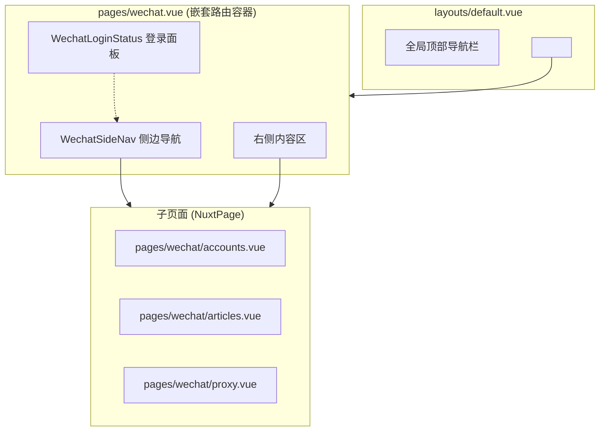
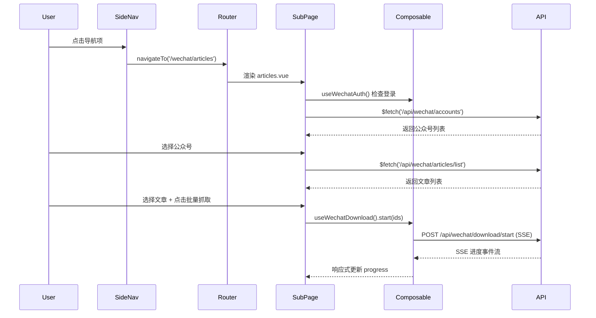

# Design Document: WeChat UI Redesign

## Overview

将现有的 `pages/wechat.vue` 单页面卡片式布局重构为仿照 wechat-article-exporter 的 Dashboard 布局：左侧固定导航栏 + 右侧自适应内容区。利用 Nuxt 3 嵌套路由机制，将公众号管理、文章下载、代理配置拆分为独立子页面，每个子功能拥有独立 URL 路径。登录状态面板移至侧边栏底部，公众号和文章列表改为表格化展示。

关键设计决策：
- 使用 Nuxt 3 嵌套路由（`pages/wechat/` 目录 + `pages/wechat.vue` 作为布局容器）实现子路由
- 新增 `components/wechat/` 目录存放微信管理专用组件
- 复用现有 `useWechatAuth` 和 `useWechatDownload` composables，不修改其接口
- 使用 Nuxt UI 的 UTable 组件实现表格化展示
- 保持与全局 `layouts/default.vue` 的兼容性，Dashboard 布局嵌套在全局导航之下

## Architecture



### 路由结构

```
/wechat              → 重定向到 /wechat/accounts
/wechat/accounts     → 公众号管理表格页
/wechat/articles     → 文章列表与下载页
/wechat/proxy        → 代理配置页
```

### 文件结构

```
pages/
  wechat.vue                    # 嵌套路由布局容器（侧边栏 + 内容区）
  wechat/
    index.vue                   # 重定向到 /wechat/accounts
    accounts.vue                # 公众号管理表格页
    articles.vue                # 文章列表与下载页
    proxy.vue                   # 代理配置页

components/
  wechat/
    WechatSideNav.vue           # 侧边导航栏组件
    WechatLoginStatus.vue       # 登录状态面板（侧边栏底部）
    WechatLoginModal.vue        # 扫码登录模态框
    WechatAccountTable.vue      # 公众号管理表格
    WechatArticleTable.vue      # 文章列表表格
    WechatAccountSelector.vue   # 公众号选择器下拉
    WechatProxyForm.vue         # 代理节点表单
```

## Components and Interfaces

### 1. 嵌套路由布局容器 (pages/wechat.vue)

```vue
<!-- 职责：提供左右两栏布局，左侧放导航+登录面板，右侧放 NuxtPage -->
<template>
  <div class="flex h-[calc(100vh-64px)]">
    <!-- 左侧导航栏 250px -->
    <aside class="w-64 border-r flex flex-col shrink-0">
      <WechatSideNav />
      <WechatLoginStatus />
    </aside>
    <!-- 右侧内容区 -->
    <main class="flex-1 overflow-y-auto">
      <NuxtPage />
    </main>
  </div>
</template>
```

### 2. WechatSideNav 侧边导航

```typescript
interface NavItem {
  label: string;
  icon: string;
  to: string;
}

// 导航项配置
const navItems: NavItem[] = [
  { label: '公众号管理', icon: 'i-heroicons-user-group', to: '/wechat/accounts' },
  { label: '文章下载', icon: 'i-heroicons-document-arrow-down', to: '/wechat/articles' },
  { label: '代理配置', icon: 'i-heroicons-server-stack', to: '/wechat/proxy' },
];
```

功能：
- 渲染导航项列表，使用 `NuxtLink` 实现路由跳转
- 通过 `useRoute()` 判断当前路径，高亮激活项
- 移动端（<768px）隐藏，提供汉堡菜单按钮切换显示

### 3. WechatLoginStatus 登录状态面板

```typescript
interface LoginStatusProps {
  // 无 props，直接使用 useWechatAuth composable
}

// 内部状态
const { isLoggedIn, nickname, avatar, authKey, login, logout } = useWechatAuth();
const showLoginModal = ref(false);
const expiryText = ref('');  // "4天 3小时 22分"
const isExpiringSoon = ref(false); // 剩余 < 1小时
```

功能：
- 已登录：显示头像、昵称、过期倒计时、退出按钮
- 未登录：显示"登录公众号"按钮
- 倒计时每秒更新，剩余 < 1小时时红色警告
- 点击登录按钮打开 WechatLoginModal

### 4. WechatLoginModal 扫码登录模态框

```typescript
interface LoginModalProps {
  modelValue: boolean; // v-model 控制显示
}

interface LoginModalEmits {
  'update:modelValue': [value: boolean];
}
```

功能：
- 使用 Nuxt UI 的 UModal 组件
- 打开时自动调用 `login()` 获取二维码
- 显示二维码图片、扫码状态文字
- 登录成功后自动关闭
- 二维码过期提供"重新获取"按钮

### 5. WechatAccountTable 公众号管理表格

```typescript
interface AccountTableProps {
  // 无 props，内部管理数据
}

// 表格列定义
const columns = [
  { key: 'index', label: '序号' },
  { key: 'avatar', label: '头像' },
  { key: 'name', label: '名称' },
  { key: 'lastSyncAt', label: '最后同步时间' },
  { key: 'articleCount', label: '文章总数' },
  { key: 'syncedCount', label: '已同步' },
  { key: 'progress', label: '同步进度' },
  { key: 'syncCompleted', label: '同步完成' },
  { key: 'actions', label: '操作' },
];

// 操作
function syncAccount(account: Account): void;
function deleteAccount(id: number): void;
function openAddDialog(): void;
function handleImport(file: File): void;
function batchSync(ids: number[]): void;
function batchDelete(ids: number[]): void;
```

功能：
- 使用 UTable 渲染公众号列表
- 进度列显示进度条（已同步/总数）
- 顶部操作区：添加按钮、批量导入按钮
- 支持行选择（checkbox），选中后显示批量操作按钮
- 操作列：同步、删除按钮

### 6. WechatArticleTable 文章列表表格

```typescript
interface ArticleTableProps {
  // 无 props，内部管理数据
}

// 表格列定义
const columns = [
  { key: 'index', label: '序号' },
  { key: 'title', label: '标题' },
  { key: 'publishedAt', label: '发布时间' },
  { key: 'downloadStatus', label: '下载状态' },
];

// 筛选状态
const selectedAccountId = ref<number | null>(null);
const dateRange = ref<[Date, Date] | null>(null);

// 操作
function loadArticles(accountId: number): void;
function batchDownload(articleIds: number[]): void;
function stopDownload(): void;
```

功能：
- 顶部：公众号选择器 + 日期区间选择器
- 使用 UTable 渲染文章列表
- 下载状态列：UBadge 标签显示"已下载"/"待下载"/"失败"
- 支持行选择，选中后显示"批量抓取"按钮
- 下载进行中显示进度条和停止按钮

### 7. WechatAccountSelector 公众号选择器

```typescript
interface AccountSelectorProps {
  modelValue: number | null;
  accounts: Account[];
}

interface AccountSelectorEmits {
  'update:modelValue': [value: number | null];
}
```

功能：
- 使用 USelectMenu 组件，支持搜索过滤
- 显示公众号头像和名称
- 选择后触发父组件加载文章

### 8. WechatProxyForm 代理节点表单

```typescript
interface ProxyFormProps {
  editingProxy?: ProxyNode | null;
}

interface ProxyFormEmits {
  saved: [];
  cancelled: [];
}

interface ProxyFormData {
  url: string;
  name: string;
  authorization: string;
}
```

## Data Models

### 前端数据类型

```typescript
// types/wechat.ts

/** 公众号信息 */
interface WechatAccount {
  id: number;
  fakeid: string;
  name: string;
  alias?: string;
  avatar?: string;
  articleCount: number;
  syncedCount: number;
  lastSyncAt: string | null;
  syncCompleted: boolean;
}

/** 文章信息 */
interface WechatArticle {
  id: number;
  title: string;
  link: string;
  authorName?: string;
  publishedAt: string;
  downloadStatus: 'pending' | 'downloaded' | 'deleted' | 'failed';
}

/** 代理节点 */
interface WechatProxy {
  id: number;
  url: string;
  name?: string;
  authorization?: string;
  isPublic: boolean;
  enabled: boolean;
  failureCount: number;
  successCount: number;
}

/** 导航项 */
interface WechatNavItem {
  label: string;
  icon: string;
  to: string;
}
```

### 数据流



### 状态管理策略

- 全局状态（登录态）：通过 `useWechatAuth` composable 的模块级变量共享
- 全局状态（下载进度）：通过 `useWechatDownload` composable 的模块级变量共享
- 页面局部状态：各子页面组件内部管理（公众号列表、文章列表、代理列表）
- 路由状态：通过 `useRoute()` 获取当前路径，驱动导航高亮


## Correctness Properties

*A property is a characteristic or behavior that should hold true across all valid executions of a system—essentially, a formal statement about what the system should do. Properties serve as the bridge between human-readable specifications and machine-verifiable correctness guarantees.*

### Property 1: Route-to-navigation highlight mapping

*For any* valid wechat sub-route path (e.g., '/wechat/accounts', '/wechat/articles', '/wechat/proxy'), the navigation component should mark exactly one nav item as active, and that item's `to` property should match the current route path.

**Validates: Requirements 1.5, 7.3**

### Property 2: Expiry countdown formatting

*For any* login session with a known `expiresAt` timestamp and a current time before expiry, the countdown formatter should produce a string that correctly represents the remaining duration in days/hours/minutes format, and the computed remaining milliseconds should equal `expiresAt - currentTime`.

**Validates: Requirements 2.2**

### Property 3: Expiry warning threshold

*For any* remaining time value, the warning state should be active if and only if the remaining time is less than 3,600,000 milliseconds (1 hour) and greater than 0.

**Validates: Requirements 2.4**

### Property 4: Sync progress calculation

*For any* account with `articleCount > 0` and `syncedCount >= 0`, the progress value should equal `syncedCount / articleCount` and be in the range [0, 1]. When `articleCount` is 0, progress should be 0.

**Validates: Requirements 3.2**

### Property 5: Row selection enables batch actions

*For any* table with selectable rows, when the set of selected row IDs is non-empty, batch action buttons should be enabled; when the set is empty, batch action buttons should be disabled.

**Validates: Requirements 3.6, 4.6**

### Property 6: Download status label mapping

*For any* valid `downloadStatus` value ('pending', 'downloaded', 'deleted', 'failed'), the status-to-label mapping function should return the corresponding Chinese label ('待下载', '已下载', '已删除', '失败'), and the mapping should be exhaustive (no status value produces an undefined label).

**Validates: Requirements 4.4**

### Property 7: Date range filtering

*For any* list of articles and a date range [startDate, endDate], the filtered result should contain exactly those articles whose `publishedAt` falls within the inclusive range, preserving their original order.

**Validates: Requirements 4.5**

### Property 8: Account selection loads correct articles

*For any* account ID selected in the Account_Selector, the loaded article list should contain only articles whose `sourceId` matches the selected account ID.

**Validates: Requirements 4.2**

### Property 9: Proxy list item rendering completeness

*For any* list of proxy nodes, each rendered list item should contain the proxy's name (or URL if name is empty), URL, and both edit and delete action buttons.

**Validates: Requirements 6.3**

### Property 10: Edit proxy populates form

*For any* proxy node in the list, triggering the edit action should populate the form fields with that proxy's exact url, name, and authorization values.

**Validates: Requirements 6.5**

## Error Handling

### 未登录状态处理

- 所有子页面在渲染前检查 `isLoggedIn` 状态
- 未登录时显示提示信息和登录按钮，不显示功能内容
- 登录过期时（API 返回 401），自动清除本地登录态并提示重新登录

### API 请求错误

- 使用 Nuxt UI 的 `useToast()` 显示错误通知
- 网络错误：显示"网络连接失败，请检查网络"
- 服务端错误（5xx）：显示"服务器错误，请稍后重试"
- 业务错误（4xx）：显示具体错误信息

### 数据加载状态

- 表格加载中显示 skeleton/loading 状态
- 空数据显示友好的空状态提示
- 操作按钮在请求进行中显示 loading 状态并禁用重复点击

### 文件导入错误

- JSON 解析失败：提示"文件格式错误，请确保为有效的 JSON 文件"
- 数据格式不符：提示具体缺失的字段信息

### 移动端适配

- 侧边栏在窄屏隐藏，通过汉堡菜单切换
- 表格在窄屏下水平滚动
- 模态框在移动端全屏显示

## Testing Strategy

### 单元测试 (Vitest)

使用 Vitest 进行单元测试，覆盖：
- 倒计时格式化函数（各种时间差的格式化输出）
- 下载状态标签映射函数
- 同步进度计算函数
- 日期区间筛选逻辑
- 导航项激活状态判断逻辑

### 属性测试 (fast-check)

使用项目已安装的 `fast-check` 库进行属性测试。配置：
- 每个属性测试最少运行 100 次迭代
- 每个测试用注释标注对应的设计文档属性编号
- 标签格式：**Feature: wechat-ui-redesign, Property {number}: {property_text}**
- 每个 correctness property 由单个 property-based test 实现

重点属性测试：
- Property 2: 倒计时格式化（生成随机时间戳，验证格式化输出正确性）
- Property 3: 警告阈值判断（生成随机剩余时间，验证阈值逻辑）
- Property 4: 进度计算（生成随机 articleCount/syncedCount，验证进度值范围）
- Property 6: 状态标签映射（枚举所有状态值，验证映射完整性）
- Property 7: 日期筛选（生成随机文章列表和日期区间，验证筛选结果正确性）

### 组件测试

- 使用 Vitest + @vue/test-utils 测试组件渲染逻辑
- 验证条件渲染（登录/未登录状态切换）
- 验证事件触发（按钮点击、表单提交）

### 测试不覆盖的范围

- CSS 布局和视觉样式（像素级精确度）
- 响应式断点行为（需要真实浏览器环境）
- 微信 API 的实际网络请求
- SSE 流的端到端集成测试
