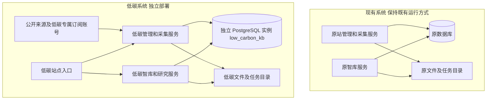

# 低碳子系统开发实施方案

| 项目 | 内容 |
| --- | --- |
| 版本 | 1.1 |
| 日期 | 2026年10月18日 |
| 适用项目 | 能源行业绿色低碳情报与决策支持平台 |
| 代码调研基线 | 当前仓库提交 bbc9f06 |
| 当前交付范围 | 开发设计及验收方案，尚不实施业务代码修改、建库、迁移、采集或部署 |

低碳子系统从现有网站的稳定代码建立独立发布版本，采用独立部署主机、反向代理、数据库实例、数据库账号、采集来源、原文库、分类规则、后台任务、接口、会话及研究档案。两套系统不交换业务数据，不设置原站资料导入、只读复用、增量同步或故障回退通道。共用的内容限于开发阶段复用的源代码、通用算法及结构定义，发布后分别运行和维护。

数据库设计采用“原系统保留原数据库，低碳系统新建 PostgreSQL 实例及 low_carbon_kb 数据库”。低碳版沿用兼容的表结构，在新库内创建完整的一套业务表。这里的隔离覆盖全部关联数据，不限于拆分文章主表，也不依赖同表中的 system_id 条件进行区分。

隔离复核已确认现有代码不能直接复制上线，包含固定原站端口、绝对锁路径、原进程控制和启动写入等依赖。[隔离审查报告](/Users/guangyi/Code/other/knowledge-base/docs/低碳子系统隔离审查报告_2026-10-18.md)记录了源码证据及 8 项内存验证。本文的部署边界和 ISO01 至 ISO14 是待实现及验收要求，当前不视为已通过双系统运行核验。

## 一 建设目标和交付边界

### 建设目标

1. 将网站适配为面向能源行业的低碳情报与决策支持平台，保留海洋能源应用特色，支持相关工业、园区和港航场景。
2. 将信息采集后的相关性判断、六领域分类、语义复核及结构化提取统一为低碳业务口径。
3. 完成导航、首页、证据中心、动态监测、态势、数据洞察和研究工作台的业务调整。
4. 跑通“独立采集—低碳分类—原文证据—项目监测—方案评价—成果保存与导出”的完整流程。
5. 以可测试的数据、接口和运行边界证明两套系统独立，低碳版维护、停止、失败或回滚不会调用或覆盖原站。

### 第一版交付内容

| 交付项 | 内容 |
| --- | --- |
| 独立运行底座 | 低碳专属站点、管理服务、智库服务、数据库实例、文件目录、任务及发布流程 |
| 六领域分类 | 固定领域标识、中文名称、中英文词表、组合规则、排除边界、分类版本与评测集 |
| 独立采集 | 单独配置来源和订阅，从公开来源或用户在低碳版上传的文件独立获得资料 |
| 低碳证据卡 | 应用场景、技术机制、阶段、指标、数据性质和逐项来源 |
| 六领域简报 | 沿用按期简报机制，使用低碳规则及本系统资料独立发布 |
| 低碳业务模块 | 首页、证据、监测、态势、图谱、数据洞察及研究工作台的统一适配 |
| 研究模板 | CCUS 运输接入、余热利用、能源替代和数智能碳改造四类研究设计 |
| 展示案例 | 独立采集公开材料、重新建立档案、完成至少一个可核对的 CCUS 方案评价案例 |
| 验收资料 | 接口与资源清单、隔离证明、分类评测、业务流程记录、备份恢复和回滚记录 |

技术机会清单作为第一版的轻量功能，以原有对象档案、事件及变化记录为基础提供候选线索；自动提醒、自动立项和后台自动复算不列入首版交付。

### 不纳入首版的能力

首版不增加企业实时计量采集、工业控制、经认证的碳核查、完整生命周期核算引擎、GIS 源汇最优匹配或多周期投资优化。公开情报中的计划能力、企业披露、研究情景与实际运行数据分别呈现。方法库中已登记但尚无执行引擎的方法，不因更名而显示为可计算。

## 二 现有实现及需要解除的依赖

现有网站包含 Nuxt 管理与采集服务，以及独立运行的 intelligence 智库模块。智库的页面路径独立，但部分管理接口、采集任务及数据库状态与原知识库相连。因此，完整隔离必须同时覆盖这两部分。

| 现有实现 | 代码位置 | 低碳版处理要求 |
| --- | --- | --- |
| 六领域带海洋适用边界和历史别名 | intelligence/industry-topics.mjs | 在低碳工作副本内替换为新标识与定义，不将原标识重新解释为低碳领域 |
| 规则分类带海洋语境门槛和主领域偏好 | intelligence/industry-classification.mjs | 改为低碳相关性及正文主旨判断，移除海洋场景作为强制条件 |
| AI 审核限制一般陆上能源等内容 | intelligence/semantic-classification.mjs、server/utils/classification.ts | 使用一致的低碳定义、边界、证据要求和独立缓存版本 |
| 提取提示词、规则字典含海洋定位 | intelligence/auto-extract.mjs、model-extract.mjs、rules.mjs | 使用低碳词典与提取模板，保留逐字证据校验 |
| 规则编辑请求根路径 /api/filters | intelligence/public/rule-editor.js | 路由到低碳管理服务，不能代理原站 |
| 订阅操作请求 /api/subscriptions、/api/rss | intelligence/public/sensing.js | 连接低碳专属账号、表、队列和管理服务 |
| 分类发布修改文章及 Mp2RSS 记录 | intelligence/processing-live.mjs、classification-jobs.mjs | 所有连接池只能连接 low_carbon_kb |
| 不同组件分别读取多个数据库变量 | intelligence/run.mjs、server.mjs、import-mp2rss.mjs、server/integrations/mp2rss-store.mjs | 统一核验数据库身份，不能只修改 INTEL_DATABASE_URL |
| 数据适配服务默认上游为 127.0.0.1:3101 | intelligence/workspace-data-server.mjs | 首版不启用该独立适配服务；需要时明确配置低碳上游，不使用默认原站端口 |
| 首次启动读取 filter/target.json 并自动播种 | server/plugins/seed-filter-rules.ts | 只加载低碳种子规则，启动顺序需先核验数据库身份 |
| 研究版本保存在数据目录的 strategy-research | intelligence/strategy/repository.mjs | 使用低碳专属目录，不复制原研究版本或沿用其来源引用 |
| 浏览器草稿及部分缓存使用 ocean 前缀 | intelligence/public/strategy/state.js、app.js 等 | 使用 lc 前缀及低碳实例标识，退出只清理本系统状态 |
| 既有部署脚本写死原目录、进程和端口 | deploy、scripts/strategy 等 | 新建低碳专用发布入口，不能直接复用原站部署命令 |

此表用于定位改造范围，不作为全仓库依赖清单。阶段零需扫描全部连接池、绝对路径、服务地址、缓存、外部凭据和有副作用的启动代码，并冻结资源清单后实施。

## 三 系统隔离架构

### 发布和代码边界

开发时从核定的稳定提交建立 codex/low-carbon-subsystem 分支及独立工作副本。低碳版的业务改动、构建产物和迁移在该副本内完成，不在原站运行目录内开发，也不通过运行时主题切换或多租户参数承载两套业务。

低碳发布包固定自身的程序版本及依赖。可以从同一 Git 仓库获取通用代码，但不把原站 current 目录、node_modules、运行环境文件或数据目录以符号链接、可写挂载等形式接入低碳服务。后续修复通过审查后分别发布，两套服务不依赖对方在线。

发布采用运行文件白名单，排除原仓库中的 source 原始采集资料、.data、.env、docs 内的业务产出、deliverables、备份、导出和测试运行数据。源码中的案例常量、固定资料 ID、演示快照和失败回退样本也需逐项检查；需要展示的业务内容在低碳版独立建立，不能随代码复制后作为新库事实使用。

两组之间没有业务数据箭头。两套系统可以各自访问同一公共机构官网，但原文、版本、摘要、翻译、向量、分类和处理状态分别取得及保存。同一篇公共文章在两库出现不构成共享记录，也不触发跨库去重、删除或同步。

### 运行资源规划

下列名称为实施目标；端口及站点域名需在阶段零检查冲突后登记。example.com 是示例域名，不是现有部署地址。

| 资源 | 原系统 | 低碳系统 |
| --- | --- | --- |
| 部署主机 | 沿用原主机 | 独立部署主机或虚拟机，独立操作系统和资源配额 |
| 站点来源 | 原有域名或 IP | 独立来源，例如 https://low-carbon.example.com |
| 反向代理及 TLS | 沿用原入口和证书配置 | 独立代理进程、配置及 TLS 私钥，不重载原站入口 |
| 管理和采集服务 | 沿用现有服务 | low-carbon-app，候选回环端口 3200 |
| 智库和研究服务 | 原 ocean-intelligence 服务 | low-carbon-intelligence，候选回环端口 3201 |
| 数据适配服务 | 原服务如已启用则保持 | 首版不启用；后续启用时独立进程及候选端口 3204 |
| PostgreSQL | 沿用原实例和数据库 | 专属实例及数据卷，数据库 low_carbon_kb |
| 存储和公网出口 | 沿用原卷和出口 | 独立数据卷、出口及采集代理，不挂载原站文件系统 |
| 系统运行身份 | 原服务身份 | 专属系统用户或容器身份 lowcarbon |
| 程序目录 | 沿用原目录 | /opt/low-carbon/releases 和 /opt/low-carbon/current |
| 持久化目录 | 沿用原目录 | /opt/low-carbon/data |
| 运行环境 | 沿用原文件 | /etc/low-carbon/app.env，独立创建及管理 |
| 日志 | 沿用原日志 | /var/log/low-carbon 或专属日志流 |
| 备份 | 沿用原策略 | /opt/low-carbon/backups 及低碳专属异地备份位置 |
| 调度 | 原队列和定时器 | low-carbon 前缀的队列、服务、定时器和锁文件 |

独立数据库不能消除共享操作系统、磁盘和入口进程的影响。为满足本次“低碳运行不影响原站”的前提，共用主机、共用 Nginx 或共用数据卷不纳入首版验收范围。低碳主机仍设置自身 CPU、内存、连接数和磁盘上限，避免自身过载；原站不承担低碳计算、流量或数据库负载。公共互联网或第三方服务整体故障属于外部条件，不能以此替代对可控制影响路径的隔离验证。

### 独立来源和外部服务

1. 不从原库复制文章、快照、订阅记录、分类结果、向量、人工核验或研究档案；不设置相关同步任务。
2. 低碳来源清单从空清单按业务方向配置，公开来源地址作为配置登记，不从原站订阅表读取。
3. Mp2RSS 及类似可修改订阅的供应商，必须使用独立账号或有明确隔离保证的独立工作区；不能仅换一个本地表，却沿用能修改原订阅集合的同一凭据。
4. 微信会话、X 接入凭据、下载代理凭据和供应商后台缓存分别保存。多账号配置中的每个账号均须满足隔离要求。
5. 尚未具备独立供应商资源的渠道保持禁用；使用独立 RSS、官网采集和低碳版文件录入完成先期流程，不借用原站账号。
6. 模型服务可使用相同供应商和模型型号，但必须核验账号或项目具有独立预算、余额约束及总并发配额。仅创建不同 API Key 不能证明隔离；无法证明额度独立时使用独立账号。提示词版本和返回结果分别保存。
7. 首版不启用外发邮件、第三方消息推送或自动订阅操作。以后启用时单独配置目标和凭据，不继承原站推送任务。
8. 低碳采集使用独立公网出口及代理并单独限流，不能共用可能按 IP 限流的原站代理或出口。供应商远端工作区、余额、账号总并发和出口边界都纳入 ISO14 核验。

## 四 数据库 文件和状态隔离设计

### 数据库及账号

低碳 PostgreSQL 实例仅承载低碳业务。应用账号不具有超级用户、创建其他数据库或管理其他角色的能力；迁移和运维使用低碳专用账号。原站数据库地址、账号和密码不进入低碳运行环境、镜像、日志或发布包。

网络和账号权限共同限制跨系统访问：低碳应用只能连接低碳数据库实例，不能连接原数据库地址、原站内部服务或原站公开业务入口；原站也不配置低碳数据库连接。低碳库不创建指向原库的外部表、dblink、外部服务器、复制订阅或跨系统触发器。

为保持代码及已有 SQL 的结构，低碳库内部可继续使用 public、classification、mp2rss、ocean_intel、ocean_research 等 schema 名称。这些名称仅属于低碳数据库中的独立对象，不代表复用原表。例如：

| 数据对象 | 实际归属 |
| --- | --- |
| 原生产库.public.articles | 只属于原系统 |
| low_carbon_kb.public.articles | 只属于低碳系统 |
| 原生产库.classification.jobs | 只管理原分类任务 |
| low_carbon_kb.classification.jobs | 只管理低碳分类任务 |

### 低碳库完整表组

以下为按当前实现整理的建库范围。业务功能启用前，相关表组必须在低碳库内完成初始化；未列出的新表也遵守相同归属规则。

| 表组 | 独立对象 | 保存内容 |
| --- | --- | --- |
| 应用身份 | public.app_instance，低碳版新增技术表 | app_id、实例标识、结构版本，供启动及迁移核验 |
| 原始资料 | public.sources、articles、article_chunks | 来源、原文、下载状态、分类摘要、检索向量 |
| 规则 | public.filter_rules | 低碳正向、排除和相关性规则 |
| 采集配置 | public.proxy_nodes、wechat_sessions、scrape_sources、scraped_data | 本系统凭据、会话、采集源和结构化采集结果 |
| 推送配置 | public.push_tasks | 仅保存低碳版配置；首版关闭外发 |
| 分类发布 | classification.jobs、previews、articles、audit | 规则发布、预览、单文分类及变化审计 |
| AI 复核 | classification.semantic_queue、semantic_cache | 低碳语义任务及模型判断缓存 |
| 订阅采集 | mp2rss.subscriptions、items、versions、manual_bodies、jobs、state、discovery | 本系统订阅、正文、历史版本、补录和队列 |
| 外链证据 | mp2rss.evidence_links、evidence_documents、evidence_versions | 低碳采集的原链、外链正文、图表线索和版本 |
| 智库资料 | ocean_intel.sources、documents、document_versions | 本系统进入智库的来源、文档及固定版本原文 |
| 结构化事实 | ocean_intel.entities、events、relations、observations、evidence | 对象、事件、关系、指标及逐项原文依据 |
| 智库状态 | ocean_intel.runs、research | 本系统快照、运行记录及循证问答成果 |
| 数据修订 | ocean_intel.data_overrides、data_change_log | 本系统人工修订和审计 |
| 研究发布 | ocean_research.records、head、runtime | 资料批次、发布版本、对象档案及成果运行状态 |
| 迁移元数据 | 低碳实例内的迁移登记表 | 本系统已应用的迁移版本和校验值 |

研究计算的不可变版本目前还保存在文件中，不能只完成数据库隔离后遗漏这部分。数据库与文件共同组成完整的低碳备份及恢复单元。

### 启动和迁移前的身份核验

低碳版新增统一的运行环境核验入口，所有服务、采集脚本、Worker、迁移和发布工具都先执行该入口，再创建业务连接池、读写文件或初始化队列。

核验项目包括：

- app_id 固定为 low-carbon，不能由浏览器参数切换为原系统。
- 必填数据库地址存在，实际 current_database 为 low_carbon_kb，数据库实例标识与部署清单一致。
- public.app_instance 已由专用初始化流程建立，其 app_id、instance_id 与当前部署匹配。缺失或不一致时拒绝启动，不自动覆盖或修复身份。
- 所有数据库连接变量都指向同一低碳实例及数据库，校验真实连接身份，不能只比较字符串。
- 文件路径经 realpath 或父目录解析后位于低碳根目录内；拒绝指向原目录的符号链接、默认目录和挂载。
- 生产密码、会话密钥及供应商配置均来自低碳环境；生产环境禁止无认证模式。
- 前端 API 基址、代理上游和 Worker 工作目录属于本系统。

数据库缺失、身份错误、路径错误或配置不全时，服务退出或返回明确不可用状态，不尝试原站地址，也不静默读取原站文件。首次建库由专用 bootstrap 流程执行，普通应用启动不承担寻找其他可用数据库的职责。

### 环境变量覆盖清单

下表中的 APP_ID、LC_INSTANCE_ID、LC_SESSION_SECRET、LC_INTELLIGENCE_BASE_URL、LC_LOCK_DIR、LC_AUTOMATION_ENABLED 和统一路径核验等属于待实现约定，不是现有代码已经支持的功能。现有变量继续按其原职责使用，但必须通过统一核验。

| 配置 | 低碳版要求 |
| --- | --- |
| APP_ID、LC_INSTANCE_ID | 新增固定应用身份与实例身份 |
| DATABASE_URL | 低碳实例的 low_carbon_kb 专属连接 |
| NUXT_DATABASE_URL | 与低碳管理服务的运行时连接一致，排除构建时残留 |
| INTEL_DATABASE_URL | 显式配置同一低碳库，不依赖原环境回退 |
| INTEL_AUDIT_DATABASE_URL | 显式配置同一低碳库，不能指向原分类审计库 |
| INTEL_DATA_DIR | /opt/low-carbon/data/intelligence |
| INTEL_AUDIT_FILE | 如启用文件审计，只能指向低碳目录，不使用原站审计快照 |
| INTEL_RESEARCH_ARCHIVE | /opt/low-carbon/data/research-archive |
| INTEL_RESEARCH_BACKEND | 使用本系统已初始化的后端，生产不因连接失败切换后端 |
| IEA_DATA_HOME | /opt/low-carbon/data/iea，授权和下载记录独立 |
| EIA_STAGE_DIR、IEA_STAGE_DIR、INTEL_UPGRADE_STAGE | 只使用低碳专属暂存目录，按真实路径核验 |
| PORT 或 NITRO_PORT、INTEL_PORT | 使用已登记的低碳端口，拒绝原站端口及冲突端口 |
| INTEL_BASE_PATH | 与低碳站点的 /workspace/ 路径一致 |
| WORKSPACE_DATA_PORT 及上游 | 首版停用；后续启用需显式传入低碳上游，删除默认 3101 回退 |
| SITE_PASSWORD、NUXT_SITE_PASSWORD | 低碳专属密码配置，构建与运行时来源一致 |
| LC_SESSION_SECRET | 新增低碳专属会话签名密钥，由本系统管理和智库服务使用，不与原站互认 |
| LC_INTELLIGENCE_BASE_URL | Worker 及脚本显式使用的低碳智库地址，不回退 3101 或原站域名 |
| LC_LOCK_DIR | /opt/low-carbon/data/locks，所有文件锁从本目录派生并强制传入 |
| LC_AUTOMATION_ENABLED | 首次启动为 false，覆盖 Nuxt 插件、智库计时器及独立自动 Worker |
| PM2_HOME 或专属服务管理配置 | 仅管理低碳进程，不加载或控制原站进程集合 |
| OPENAI_API_KEY 及 NUXT 对应配置 | 低碳专属项目或凭据，不复制原站环境文件 |
| MP2_RSS_LINK、MP2_RSS_EXTRA_LINKS | 仅可登记低碳独立账号，不混入原站账号 |
| DOWNLOAD_PROXY、MP2_EVIDENCE_PROXY 及代理配置 | 使用低碳专属凭据、出口和状态目录 |
| INTEL_SCHEDULE 及外部定时器 | 初始关闭，手工流程及隔离验收通过后逐项开启 |
| SMTP 及推送配置 | 首版不配置原站收件人、任务或密钥 |

启动器只传入本系统所需的环境白名单，清理继承的数据库、代理及服务地址。不能从原站进程环境或 .env 文件加载缺省配置。

### 文件和浏览器状态

| 数据类型 | 低碳归属位置或命名 |
| --- | --- |
| 原文、固定版本、快照 | /opt/low-carbon/data/intelligence 下的独立文件 |
| 上传、OCR 和识别结果 | 低碳数据根目录内的 uploads 及对应状态目录 |
| 简报、补充采集、处理任务 | 低碳数据根目录内的 period-reports、object-supplements、processing-runs 等目录 |
| 研究计算版本和案例索引 | 本系统 strategy-research、strategy-cases 目录 |
| 临时下载、暂存和采集阶段文件 | 低碳专属 tmp、stage 目录；完成或失败按任务清理 |
| 日志及锁文件 | low-carbon 前缀路径，系统身份只管理自身文件 |
| 浏览器草稿和缓存 | lc:{instanceId}: 前缀，包含草稿、筛选、简报选择、地图和主题状态 |
| 会话 Cookie | lc_site_auth，Host-only，Path=/，独立密钥和应用身份 |
| 备份和恢复暂存 | 低碳专属备份目录及恢复实例 |

浏览器存储按来源区分，Cookie 不按端口区分。因此即使开发环境采用不同端口，也要使用独立 Cookie 名称、签名及应用身份。低碳认证不接受原有 site_auth、ocean_auth 作为后备凭据。

低碳管理和智库统一使用 lc_site_auth：两个登录入口均调用本系统认证逻辑，签名绑定 app_id、instance_id 和过期时间，两个服务使用相同的低碳验签规范。登录后根路径管理 API 和 /workspace/ 智库 API 均可使用；退出同时撤销本系统会话并清理本系统草稿。Cookie 设置 HttpOnly，生产 HTTPS 下设置 Secure 和合适的 SameSite，不设置父域 Domain，不使用原站密钥或跨系统单点登录。

## 五 接口和站点隔离设计

### 站点路由

优先为低碳版使用独立 Host，沿用现有“管理服务＋智库服务”结构，以减少前端和框架路由改动。低碳入口的示例路由如下。

| 低碳 Host 下的路径 | 处理服务 | 约束 |
| --- | --- | --- |
| / | 跳转 /workspace/ | 只跳转低碳页面 |
| /workspace/ 及其静态资源 | low-carbon-intelligence | 仅取低碳发布包 |
| /workspace/api/** | low-carbon-intelligence | 仅访问低碳数据与研究档案 |
| /api/filters/** | low-carbon-app | 只编辑及发布低碳规则 |
| /api/subscriptions/**、/api/rss/** | low-carbon-app | 只管理低碳订阅及任务 |
| /api/articles/**、/api/scraper/**、/api/sources/** | low-carbon-app | 只处理低碳原始资料 |
| /api/auth/**、/api/wechat/** | low-carbon-app | 使用低碳认证和供应商会话 |
| /admin、/wechat/**、/articles、/filters 等管理页面 | low-carbon-app | 只显示低碳管理内容 |
| /_nuxt/** 等管理静态资源 | low-carbon-app | 只取低碳构建产物 |
| 未登记路径 | 低碳服务的 404 | 不回退原站或使用原站 upstream |

两个独立 Host 可以分别存在 /api/filters 等相同路径，但它们属于不同服务、不同会话和不同数据库。部署文件中必须显式列出 Host 与 upstream 对应关系，不能把低碳 Host 的某些根 API 转发到原站。

智库代理按现有服务契约去掉 /workspace/ 前缀，例如外部 /workspace/api/data 到达低碳智库时为 /api/data；管理 API 保留 /api/ 前缀。静态资源及前端相对请求使用相同的低碳基址，规则编辑等根路径请求则只落在低碳 Host 的管理服务。

若实施时尚无独立域名，先使用低碳专属监听入口完成开发验收。不得直接挂到原站目录后沿用原站根 API；同 Host 的路径部署需要另行完成所有管理 API、静态路径和认证范围适配，不能作为未经验证的临时捷径。

### API 隔离契约

1. API 客户端通过低碳统一入口生成地址，禁止写死原站域名、IP、端口和 /ocean-intelligence/ 链接。
2. 后端系统身份来自部署配置；请求中的 system_id、app_id 或 URL 参数不能选择数据库、文件根目录或代理上游。
3. 所有业务读取、创建、编辑、删除、重新分类、采集、导出及计算都在 low_carbon_kb 和低碳文件根目录内完成。
4. 原站的文章 ID、资料版本、任务 ID 或研究 ID 即使格式合法，也不能触发回源查询。只查询本系统，未找到返回 404。
5. 对格式相同、甚至值相同的 ID，按当前数据库中的记录解释；不存在跨系统全局 ID 映射。
6. 写接口校验来源及低碳会话；不开放能携带原站 Cookie 的跨站凭据请求，也不建立跨系统登录或注销联动。
7. 受认证保护的 /workspace/api/system 提供 appId、instanceId、buildVersion、taxonomyVersion 等非敏感身份信息，供验收核对；不返回连接串、密钥或私有网络详情。
8. 日志记录本系统实例、请求及任务标识，便于定位；相同查询只能命中本系统缓存。
9. 来源采集器拒绝把原站业务入口登记为采集源。两套业务服务相互不调用，不互相探测健康；原站的只读核对由独立运维身份执行。

### 关键接口验收分组

| 分组 | 需要覆盖的操作 |
| --- | --- |
| 规则 | 查询、保存、导入、预览、发布、重新分类、任务状态与明细 |
| 采集 | 来源登记、订阅、取消订阅、同步、正文补全、重试和失败记录 |
| 证据 | 原文及固定版本读取、资料筛选、指标和关系证据跳转 |
| 简报 | 范围预览、生成、发布、历史版本和导出 |
| 数据 | 统计序列、登记数据、人工修订、CSV 导出及筛选口径 |
| 研究 | 目录、方法推荐、方法确认、输入核验、计算保存、版本重现、问答与导出 |
| 认证 | 登录、管理与智库互认、过期、退出、原站凭据拒绝及跨来源请求拒绝 |
| 异常 | 本库不可用、供应商异常、未知 ID、错误上游和任务中断，不调用原站 |

## 六 六领域定义和关键词规范

### 领域标识

分类版本初始设为 low-carbon-six-v1.0.0。固定标识用于规则、接口、数据库、研究模板和导出；中文名称用于展示。改显示名称不改变固定标识；领域边界变化应发布新的分类版本，并保留历史成果采用的版本。

| 固定标识 | 显示名称 | 可用显示别名 |
| --- | --- | --- |
| lc_ccus_removal | CCUS与碳移除 | 碳捕集利用与封存、CCUS与碳移除 |
| lc_efficiency_recovery | 节能工艺与余能利用 | 节能工艺、余能利用 |
| lc_clean_energy_integration | 清洁能源与多能协同 | 清洁能源、多能协同 |
| lc_equipment_materials | 绿色装备与低碳材料 | 绿色装备、低碳材料 |
| lc_digital_carbon_management | 数智降碳与碳管理 | 数智降碳、碳管理 |
| lc_strategy_market | 低碳战略与市场机制 | 低碳战略、市场机制 |

显示别名仅帮助定位领域，不能不经上下文判断就把所有包含该词的文章纳入。原版的海洋油气、海上风电等存储标识不加入新领域别名；海上风电作为技术关键词进入新分类，而不是把原分类记录直接改名。

### CCUS与碳移除

定义：覆盖二氧化碳捕集、运输、利用、封存链条，以及具有明确移除或碳汇研究对象的技术和项目。分别标注避免排放、碳利用、碳移除及自然碳汇，不能将各类数量合并为同一种减排效果。

| 词表类型 | 内容 |
| --- | --- |
| 中文强关联词 | 碳捕集、二氧化碳捕集、碳捕集利用与封存、二氧化碳运输、二氧化碳地质封存、海底碳封存、源汇匹配、碳矿化、直接空气捕集、生物质碳捕集与封存、二氧化碳移除、海洋碳汇、蓝碳 |
| 英文强关联词 | carbon capture、carbon capture utilisation and storage、carbon capture utilization and storage、CO2 transport、CO₂ transport、geological CO2 storage、subsea carbon storage、direct air capture、bioenergy with carbon capture and storage、carbon dioxide removal、blue carbon |
| 需语境复核的词 | CCUS、CCS、CCU、DAC、BECCS、CDR、捕集率、注入量、封存能力、碳汇、红树林、海草床、盐沼、二氧化碳驱油 |
| 组合条件示例 | 捕集或运输或封存或矿化，与二氧化碳或 CO2 或 CO₂ 出现在同一事实段；红树林或海草床或盐沼，与碳汇或固碳或碳核算出现在同一研究段 |
| 排除及转归 | 普通二氧化碳工业气体采购、与碳业务无关的 CCS 缩写、无碳汇内容的生态观光不直接纳入；以碳资产制度为主归第六领域 |

### 节能工艺与余能利用

定义：覆盖生产或运行流程中的能效提升、工艺改造、余热余压余气利用，以及火炬气回收、甲烷泄漏控制等过程减排。以场景和工艺应用为主，装备本体研发制造另归第四领域。

| 词表类型 | 内容 |
| --- | --- |
| 中文强关联词 | 节能改造、工艺节能、能效提升、流程节能、余热回收、余热发电、余压利用、余气利用、低温余热、热集成、梯级用能、蒸汽系统优化、火炬气回收、甲烷减排、泄漏检测与修复 |
| 英文强关联词 | energy efficiency improvement、energy-saving retrofit、waste heat recovery、waste heat to power、waste pressure recovery、process integration、heat integration、steam system optimisation、steam system optimization、flare gas recovery、methane abatement、leak detection and repair |
| 需语境复核的词 | 工艺优化、流程优化、节能、降耗、热泵、换热器、变频、余气、LDAR、泄漏治理、设备运行优化 |
| 组合条件示例 | 工艺或流程或蒸汽或供热，与能耗降低或能效提升或节能出现在同一应用段；甲烷或天然气，与泄漏检测或泄漏修复或回收出现在同一段 |
| 排除及转归 | 单纯增产、缩短工期、一般安全巡检、无节能事实的成本优化不直接纳入；以新型高效设备研制交付为主归第四领域 |

### 清洁能源与多能协同

定义：覆盖低碳能源生产、替代和协同供能，保留海洋新能源和平台电气化特色，同时支持陆上工业及园区应用。项目的供能结构、协同关系和适用条件必须明确。

| 词表类型 | 内容 |
| --- | --- |
| 中文强关联词 | 海上风电、漂浮式风电、海上光伏、波浪能、潮汐能、潮流能、可再生能源制氢、绿氢、绿色甲醇、绿氨、绿电替代、源网荷储、风光储氢、多能互补、综合能源系统、海上能源岛、平台电气化、港口岸电 |
| 英文强关联词 | offshore wind、floating wind、offshore solar、wave energy、tidal energy、renewable hydrogen、green hydrogen、renewable methanol、green ammonia、renewable electricity substitution、integrated energy system、hybrid energy system、offshore electrification、shore power |
| 需语境复核的词 | 光伏、风电、核能、氢能、甲醇、氨、储能、微电网、生物质能、综合能源、天然气替代、海水制氢 |
| 组合条件示例 | 储能或微电网，与可再生能源消纳或削峰调度或低碳供能出现在同一应用段；氢或甲醇或氨，与可再生能源来源或明确生命周期排放依据出现在同一段 |
| 排除及转归 | 常规油气增产不因能源属性纳入；常规制氢、普通化工甲醇、未说明用途的电池订单不自动认定为低碳；以装备或材料技术为主归第四领域 |

### 绿色装备与低碳材料

定义：覆盖直接用于节能降碳的装备研发、制造、应用性能及材料替代，包括捕集材料、低碳基础材料和与资源节约明确相关的再制造。

| 词表类型 | 内容 |
| --- | --- |
| 中文强关联词 | 高效电机、节能泵、节能压缩机、工业热泵、碳捕集装备、二氧化碳压缩机、捕集吸收剂、碳捕集吸附剂、二氧化碳分离膜、低碳钢、低碳水泥、低熟料水泥、低碳胶凝材料、装备再制造、低碳材料替代 |
| 英文强关联词 | energy-efficient motor、energy-efficient pump、industrial heat pump、carbon capture equipment、CO2 separation membrane、carbon capture sorbent、low-carbon steel、low-carbon cement、low-clinker cement、low-carbon materials、remanufacturing |
| 需语境复核的词 | 装备、绿色装备、吸收剂、吸附剂、分离膜、电解槽、再生材料、轻量化、循环利用、国产化、交付、中标 |
| 组合条件示例 | 装备或材料或电机或泵或压缩机，与明确节能性能或捕集用途或低碳替代出现在同一段；再生材料或轻量化，与特定能源场景或碳排放比较出现在同一段 |
| 排除及转归 | 普通钻井平台、商船、材料订单和国产化消息不因装备属性纳入；以工厂利用装备开展节能改造为主归第二领域 |

### 数智降碳与碳管理

定义：覆盖数字技术在能源及碳管理中的应用，包括监测、核算、诊断、调度和方案支持。数字技术必须服务于明确的能耗或碳业务目标。

| 词表类型 | 内容 |
| --- | --- |
| 中文强关联词 | 数智降碳、能碳管理、能碳管理平台、能源管理系统、能耗在线监测、碳排放监测、碳排放核算、产品碳足迹、碳足迹核算、AI节能、人工智能节能、智能能效诊断、能源数字孪生、碳数据质量管理 |
| 英文强关联词 | energy management system、energy and carbon management、carbon accounting、carbon emissions monitoring、carbon footprint、life cycle assessment、AI for energy efficiency、digital energy management、carbon data management |
| 需语境复核的词 | 人工智能、AI、数字孪生、智能调度、预测性维护、工业互联网、LCA、MRV、EMS、能耗预测、绿色数据中心 |
| 组合条件示例 | AI或数字孪生或智能调度或预测性维护，与节能或能耗或排放或碳核算出现在同一应用段；MRV 与明确的温室气体或碳项目对象同时出现 |
| 排除及转归 | 一般 AI 新闻、通用工业软件、仅提升办公效率的工具不直接纳入；以碳核算标准或监管制度发布为主归第六领域 |

### 低碳战略与市场机制

定义：覆盖绿色低碳战略规划、转型路径、政策标准、碳市场、碳资产、绿色金融及管理体系，兼顾企业、行业和公共治理层面。

| 词表类型 | 内容 |
| --- | --- |
| 中文强关联词 | 碳达峰、碳中和、双碳规划、低碳转型战略、减碳路线图、碳预算、碳排放权交易、碳市场、碳配额、碳定价、碳资产管理、低碳标准、绿色供应链管理、转型金融、绿色管理体系 |
| 英文强关联词 | carbon peaking、carbon neutrality、decarbonisation roadmap、decarbonization roadmap、net-zero strategy、carbon budget、emissions trading system、carbon market、carbon allowance、carbon pricing、carbon asset management、transition finance、green supply chain management |
| 需语境复核的词 | 双碳、绿色金融、绿色采购、CCER、碳信用、ESG、可持续发展、绿色工厂、绿色园区、管理体系、国际合作 |
| 组合条件示例 | 政策或标准或规划或制度或市场，与低碳或碳排放或能效或碳交易出现在同一适用段；ESG 与明确的能源转型或温室气体管理要求同时出现 |
| 排除及转归 | 一般宏观经济、普通金融、无气候内容的 ESG 公益及企业宣传不直接纳入；以某项技术应用为主的企业项目新闻归相应技术领域 |

### 通用匹配和分类规则

分类流程为：正文完整性检查—内容类型判断—低碳相关性判断—领域候选—主旨判断—必要的语义复核—证据与版本保存。领域分类不强制包含海洋词，也不要求所有文章已经披露数值减排效果；具有明确技术机制、政策适用性或碳管理对象即可形成有依据的相关性判断。

1. 中文按原词及经核定的等价写法匹配；英文大小写不敏感，短词和缩写使用单词边界。CO₂ 与 CO2 等匹配归一化不能改变原文证据位置。
2. 强关联词可形成领域候选；词只出现在转载目录、参考文献、广告页脚或被否定的背景句时，不能据此自动纳入。
3. 需语境复核的词必须满足组合条件或经语义复核确认。能源、绿色、环保、智能、数字化、项目、中标、合作、自然资源部、国家能源局等宽泛词或机构名不能单独成为纳入依据。
4. 组合规则的不同组须在同一完整事实段内成立，不能把文章开头的 AI 与结尾的碳中和拼成一项数智降碳应用。段落过长时按完整句群切分，保留其原文偏移。
5. 高确定的招聘、招生、商品促销和无正文页面按主体内容排除；正文包含培训、会议或论坛不自动排除，技术报告和政策解读仍可纳入。
6. 人工核定结果优先保留。重新分类前显示影响预览；正文版本发生变化时另建复核任务，保留先前核定及原因。
7. 每篇已纳入资料保存一个主领域及多个辅助领域。主领域根据核心研究对象或主要行为确定，不按六领域序号简单抢占。
8. 政策、标准和市场制度本身为主要对象时归第六领域；数字方法本身为主要创新且有明确能碳用途时归第五领域；其余按技术、工艺、能源系统或装备材料主旨归类。
9. 无法确定主旨或证据不足时保持 unmatched，不把六领域中的任意一类作为默认兜底。
10. 统计总量按本系统文档去重；主领域计数互斥。辅助标签的交叉计数需标明口径，不把多标签数求和当文章总数。

强词规则和组合规则分别保存。现有 require_all 与 groups 字段可继续承载组合词；段落级语境、主体内容排除和主旨判断需在低碳分类器中实现后再生成发布规则，不能把本节整张词表直接平铺导入现有匹配器。

### AI 语义复核契约

复核提示词包含六领域定义、排除边界、原文段落编号和当前分类版本。模型只判断给定文本，不读取原站资料，也不执行附件或网页中的指令。

返回字段至少包含 relevant、primaryTopic、secondaryTopics、reason、evidenceIds 和 uncertainty。固定标识必须属于六领域；引用编号必须存在，原文片段必须实际支持判断。不合法标识、无依据引用、截断或模型失败时不提升为 accepted，保存可重试状态。

模型返回值由适配层校验后转换为现有 classification.primary、classification.topics、reason 及 semantic 证据结构；保持下游 accepted、excluded、unmatched 的状态契约。模型字段名称不直接替换现有数据库与页面契约。

缓存键至少包含本系统实例标识、正文内容版本、规则版本、提示词版本及模型标识。AI 复核、正文结构化提取、研究方法推荐采用各自的版本与缓存，不能相互冒用结果。

### 必测分类样例

下列为验收用合成标题及场景，不是已经采集的真实新闻。

| 样例 | 预期结果 |
| --- | --- |
| 陆上水泥厂开展二氧化碳捕集与地质封存示范 | 第一领域，不要求出现海洋词 |
| 红树林修复项目开展蓝碳核算与碳汇量评估 | 第一领域，记录自然碳汇属性 |
| 某油田新增常规原油产能，无节能降碳事实 | 不直接纳入 |
| 某工厂利用工业热泵回收余热，降低供热能耗 | 第二领域，第四领域辅助标签 |
| 企业发布新型高效工业热泵及性能试验结果 | 第四领域，第二领域辅助标签 |
| 绿电制氢与储能联合供能示范 | 第三领域 |
| 企业新增常规甲醇产能，无能源来源或排放依据 | 不直接纳入第三领域 |
| 数字孪生平台依据能耗数据优化压缩机调度 | 第五领域 |
| 通用数字孪生建模软件发布，无能碳应用 | 不直接纳入第五领域 |
| 发布 CCUS 项目支持政策 | 第六领域，第一领域辅助标签 |
| 碳核算培训招生广告，无实质技术或政策内容 | 排除 |
| 技术论坛报告介绍甲烷泄漏检测和实测结果 | 第二领域，不因论坛一词排除 |
| 单独出现 CCS 或 EMS 且无业务语境 | unmatched，不依靠缩写强行纳入 |
| 正文前段介绍办公 AI，末段仅有低碳口号 | 不判为数智降碳应用 |

## 七 模块调整和页面要求

### 统一名称及能力

| 当前模块 | 低碳版名称 | 首版调整 |
| --- | --- | --- |
| 首页 | 低碳智研首页 | 展示六领域、本期简报、重点项目变化及完整研究案例入口 |
| 全球信息感知 | 全球低碳信息感知 | 独立来源清单、采集任务、正文获取、分类投递及失败原因 |
| 情报证据中心 | 低碳情报证据中心 | 六领域筛选、原文与译文、固定版本、证据卡及分类依据 |
| 行业动态监测 | 低碳技术与项目监测 | 对象档案、技术和项目阶段、变化记录、关系及候选机会 |
| 全球态势总览 | 全球低碳发展态势 | 当前收录资料及项目的国家和地域线索，保留统计范围说明 |
| 产业关联图谱及关系视图 | 低碳创新协同图谱 | 企业、机构、技术、项目和设施之间有原文依据的关系 |
| 行业数据洞察 | 低碳产业与能效洞察 | 可比序列、项目登记、低碳指标及来源明细 |
| 量化分析或战略研究工作台 | 低碳转型研究工作台 | 低碳选题、方法、方案评价、情景研究、版本和问答 |

主导航仍按现有工作路径组织，图谱可继续作为监测中的关系视图，不要求新增重复的一级页面。更名同步覆盖页面标题、浏览器标题、首页入口、空状态、面包屑、提示词、导出标题及案例说明。

首页突出“发现低碳变化、比较低碳方案、形成研究成果”。六领域卡片中的数字只能来自本系统已发布资料；资料不足显示缺口和采集状态，不从原站补数。主视觉、品牌、图标和案例标识与低碳主题一致，不把示意动画显示为实时任务或实际减排过程。

### 工作台内部名称

| 当前功能 | 调整后名称 | 行为约束 |
| --- | --- | --- |
| 智能选题推荐 | 低碳研究选题 | 只读取低碳数据目录，缺少数据时列出缺口 |
| 战略量化研究 | 低碳方案量化评价 | 使用已接入算法及已核定输入 |
| 战略研究方法库 | 低碳决策方法库 | 清楚区分方法登记、引擎接入和输入就绪状态 |
| 研究成果管理 | 低碳研究成果库 | 仅查询本系统不可变版本、版本关系和差异 |
| 循证研究问答 | 低碳循证问答 | 使用本系统资料、原始引用与冻结计算结果 |

### 低碳技术机会清单

先在监测模块内增加候选列表，候选类型包括新增技术、示范进展、项目阶段变化、合作线索及政策更新。每条候选显示触发事件、关联对象、原文、资料日期、适用场景和需核实事项，并支持人工确认或忽略。

候选清单不自动产生项目估值、商业机会评分、技术成熟度分值或真实减排结论。普通转载和同一事件的多条报道先做来源与事件归并，不能用报道数量抬高机会优先级。

### 低碳数据洞察

优先支持有明确来源和口径的实际能耗、单位产品能耗、绿电使用、甲烷排放、捕集量、运输量、封存量和项目状态。装机、设计捕集能力和合同服务规模作为各自性质的指标展示，不统一换算为已实现减排。

每张图必须能展开指标定义、对象、期间、单位、数值性质、来源及计算方式。没有可比序列时展示原始记录或缺口，不把零散报道指标拼为产业增长曲线。原版的原油产量、平台收入等序列不因界面改名自动进入低碳图表。

## 八 证据和数据模型适配

### 低碳证据卡

优先在现有文档、对象及 observations 的 JSON 数据中增加可选 lowCarbon 扩展，保持原有证据 ID、文档版本、人工核定和研究输入机制。低碳专属扩展只在新库及新文件中产生。

| 字段 | 内容及校验 |
| --- | --- |
| schemaVersion | 低碳扩展结构版本 |
| primaryTopic、secondaryTopics | 六领域固定标识及辅助领域，不与旧存储标识混用 |
| applicationScenarios | 油气生产、工厂、园区、港航、供热、供电、CO2 运输等受控场景 |
| mechanisms | 节能、能源替代、捕集、封存、泄漏控制、材料替代、碳移除或管理改进等机制 |
| projectStage | 研究、试验、示范、建设、计划投运、实际运行、暂停等；没有依据时为未知 |
| metrics | 指向现有指标记录，包含对象、数值、单位、期间、性质和证据 |
| baseline | 原文披露或研究者核定的基准方案；没有依据则为空 |
| systemBoundary、functionalUnit | 实际披露或研究核定的边界和功能单位 |
| claimedBenefits | 资料中明确披露的收益或减排主张，保留归属，不能直接标记为独立验证结果 |
| evidenceRefs | 本系统 documentId、versionId、quote、原文偏移及来源链接 |
| verification | 机器提取、人工核定、核定人、时间、说明及历史；不凭来源级别自动升级为已验证 |

辅助标签先使用受控词表及明确的未知值，不由模型无限新增名称。展示层提供原文和字段依据；原文缺失的字段保持为空，不使用模型常识补出事实。

主领域及辅助领域以对应规则版本的 classification 记录为准，证据卡从该记录派生展示，不另设一份可独立编辑的分类主账，避免同一文档在卡片、简报和数据洞察中出现不同归属。

### 数值性质和单位

沿用并规范现有的实际、计划、预测、设计能力等性质；研究情景、专家判断和演示设定只在研究输入中明确标记。指标性质、核验状态和数据来源是三个不同维度。

必须区分 tCO2 与 tCO2e、功率与电量、年度量与某次运行量、项目总量与单位产品强度、捕集量与实际封存量。单位换算保留原值和换算公式；缺失期间、对象或关键边界的指标可作为线索保存，但不进入同口径趋势和方案矩阵。

净减排判断需要明确基准、运行及相关环节排放等边界。首版不从捕集或封存能力直接推算净减排，也不自动把多个项目披露数值累计成平台创造的减排量。

### 低碳来源建设

| 领域 | 优先来源类型 | 应优先取得的内容 |
| --- | --- | --- |
| CCUS与碳移除 | 项目业主、官方项目登记、研究机构和原始技术报告 | 捕集运输封存链条、项目阶段、实际与设计量 |
| 节能工艺与余能利用 | 节能主管部门、行业协会、应用企业和工程案例 | 改造对象、能耗基准、实际运行数据及条件 |
| 清洁能源与多能协同 | 能源主管部门、统计发布、项目业主和系统运营方 | 能源来源、供能结构、项目投运和可比序列 |
| 绿色装备与低碳材料 | 产品技术资料、检测报告、企业公告和科研原文 | 装备用途、性能条件、材料替代依据 |
| 数智降碳与碳管理 | 实施单位、方法研究、系统技术资料及核算实践 | 数据需求、优化机制、计量口径和应用结果 |
| 低碳战略与市场机制 | 政府及监管发布、标准发布和市场运营机构 | 原始政策、适用对象、发布日期和生效信息 |

每个来源单独登记发布主体、入口、获取方式、授权要求、检查周期及覆盖领域。供应商或聚合器和原始发布主体分开记录。相同稿件的多次转载不作为多个独立事实来源。

首版数据目标为每个领域至少 20 篇独立去重、已纳入且正文完整的资料，并覆盖至少 2 个独立发布主体；全库至少 120 篇。达不到时应补采真实资料，不用原站数据或复制条目补足。该目标属于首版内容验收，不代表全行业覆盖。

采集采用按源增量及版本去重；失败保留本系统已有版本并记录重试。采集窗口、原文发布日期、事件日期、指标统计期和数据读取时间分别保存。调度检查频率不等于来源实际更新频率。

## 九 研究模板和完整展示案例

### 首版研究模板

| 模板 | 研究对象 | 输入要求 | 首版采用的能力 |
| --- | --- | --- | --- |
| CCUS 运输接入方案比较 | 同一服务需求下的候选运输及接入安排 | 统一服务规模、成本、投入、准备期、保障能力和相关排放边界；逐格依据 | 综合评价、权重敏感性及情景分析 |
| 余热利用方案评价 | 同一工厂供热需求下的候选方案 | 余热品质、用热需求、工况、能源价格口径、投入及运行量 | 综合评价；有真实现金流或明确情景时使用 NPV |
| 能源替代方案研究 | 指定平台、设施或园区的供能方案 | 负荷、供能边界、接入条件、可靠性约束和同口径方案数据 | 综合评价及已接入的确定性情景分析 |
| 数智能碳改造评价 | 明确能碳目标下的数字化改造方案 | 数据基础、接入对象、实施成本、维护需求、优化机制及评价依据 | 综合评价、方案对照和研究版本比较 |

模板属于可复用研究设计，不能因有文章线索就自动显示输入就绪。先核验安全、许可、服务规模等硬约束，再进行评分；综合评分不能替代工程可行性、真实成本或减排核定。

### CCUS 案例建设路径

1. 使用低碳采集器重新获取项目业主公开原文，保存在低碳原文库。可沿用公开案例的研究思路，不复制原站数据库或冻结研究文件。
2. 生成本系统文档、版本、证据、项目和事件 ID，核对发布日期、原文摘要与事实。
3. 明确事实底稿、计划信息和研究情景。情景矩阵不标为企业报价或真实工程数据。
4. 在低碳工作台预填研究问题、功能单位、系统边界、候选方案、指标和逐格依据。
5. 走原生的方法匹配、人工确认、输入核验和计算保存流程，建立本系统不可变版本；不直接写伪造的已计算 JSON。
6. 保存基准及至少一个有明确变化理由的子版本，验证结果重现、参数变化及敏感性说明。
7. 在本系统问答和导出中引用本系统原文及冻结结果，清除原案例中的原站 API 和版本链接。
8. 验收时从首页入口连续演示，不借助原站登录、资料、接口或文件。

### 成果要求

成果至少包含研究问题、范围和时点、输入来源及性质、方法选择依据、参数、硬约束检查、结果及敏感性、适用条件、局限和后续补数事项。保存后保留算法及输入版本，更新数据时建立新版本，不覆盖既有计算。

## 十 分阶段实施和交付门槛

各阶段按依赖顺序推进，前一阶段的阻断项关闭后进入下一阶段。预计开发和测试投入为 12 至 18 人日，以下为工作量估算，不包含域名、账号开通、来源授权等外部等待时间。具体日期在实施启动时按可用人员及资源排期。

| 阶段 | 工作内容 | 交付物 | 阶段验收门槛 | 预计投入 |
| --- | --- | --- | --- | --- |
| 阶段零 范围和基线 | 核定低碳副本基线；盘点连接池、接口、路径、队列、供应商、进程与隐式默认值；落实独立主机、入口及供应商额度；建立原站只读基线 | 架构和资源清单、原站保护清单、低碳配置样表、测试计划 | 所有资源有明确归属；独立主机及额度边界可验证；原站凭据和数据不进入低碳清单 | 1 人日 |
| 阶段一 独立运行底座 | 建立独立工作副本、部署主机、入口代理、服务身份、PostgreSQL 实例、库和目录；完成认证、启动核验、初始化和空状态 | 低碳专属部署包、建库初始化流程、资源身份清单、空库可运行站点 | 只读写本库；错误实例拒绝启动；原站离线时低碳仍可工作；无跨系统挂载、代理、锁和进程管理权限 | 2 至 3 人日 |
| 阶段二 独立采集和六领域 | 配置独立来源；实现词表、段落组合、主旨分类、语义复核、缓存版本、重分类预览及独立投递 | 六领域规则包、来源清单、分类样本集、评测报告、端到端采集记录 | 六领域和排除样例通过；独立采集达内容目标；分类指标达标；重分类不触及原系统 | 3 至 4 人日 |
| 阶段三 模块和证据卡 | 调整品牌、导航和页面；构建低碳证据卡、项目监测、态势、图谱、指标明细及简报 | 低碳页面、证据卡、按期简报、轻量机会清单 | 页面和导出口径一致；每项事实可回溯本系统原文；跨页筛选、空状态及历史版本通过 | 2 至 3 人日 |
| 阶段四 工作台和案例 | 调整选题、词典、模板及提示词；完成 CCUS 独立案例和原生计算流程 | 四类模板、至少一个完整案例、基准及子版本、可导出成果 | 方法确认、输入核验、保存、重现、版本比较及问答全部通过；不存在原站研究链接 | 2 至 3 人日 |
| 阶段五 综合验收 | 执行隔离、故障、接口、分类、数据口径、浏览器、性能、恢复与回滚演练 | 验收报告、测试证据、未决项清单和候选发布包 | 所有隔离阻断项通过；无影响关键流程的高优先级问题；恢复与回滚可执行 | 1 至 2 人日 |
| 阶段六 独立发布和试运行 | 发布专属站点与服务；逐项启用已验收调度；连续观察；核对原站未被修改 | 发布清单、低碳身份记录、试运行记录、运维手册和演示路径 | 连续 48 小时试运行通过；至少完成一个采集分析周期和一个简报周期；原站无低碳引入的异常 | 1 至 2 人日 |

阶段六的观察时间为自然经过时间，不计为连续占用的开发人日。采集周期较长时，使用受控手动运行验证同一任务入口，再观察正常计划运行，不能为演示临时伪造已完成任务。

### 阶段一的初始化顺序

1. 建立低碳专属部署主机、入口、基础资源和运行身份，阻断访问原数据库、原服务及原文件根目录。
2. 由低碳专用初始化工具核验目标实例及空库，安装所需扩展，建立应用身份表并应用本系统迁移。
3. 在新库初始化 public、classification、mp2rss、ocean_intel、ocean_research 等所需表组；按实际启用功能核对关系和索引。
4. 加载低碳六领域种子规则，建立合法的首个规则发布版本。空库初始化不能通过插入虚假文章绕过版本校验。
5. 在低碳目录创建符合现有结构的空快照和运行元数据，引用本系统实例及规则版本。
6. 启动低碳管理服务和智库服务，验证登录、空库页面及错误配置拒绝行为。
7. 手动采集小批真实来源，确认数据库、文件、任务及 API 归属；通过后进入阶段二。

生产启动配置必须与初始化工具分开。不能让普通进程在未核验数据库身份时执行现有自动播种、建表或订阅刷新逻辑。

当前 INTEL_SCHEDULE 只控制智库计时器，不能关闭 Nuxt 抓取插件、手动 API 或所有 systemd Worker。低碳版应在自动任务注册前检查 LC_AUTOMATION_ENABLED，首次启动不注册自动任务；手动任务也必须先核验本系统身份、上游和锁目录。所有原站固定端口、默认锁路径及原进程名称都应从低碳可执行路径中移除，不能寄希望于部署时没有触发。

### 阶段之间的版本管理

每阶段交付记录代码提交、构建版本、结构版本、分类版本、提示词版本及验收数据版本。依赖和配置在发布清单中固定，禁止从原站 current 或环境文件读取“最新配置”。

低碳版内部的规则更新通过预览、发布、重分类及历史保留完成；更新源代码不会自动改写人工核定、历史简报和冻结研究版本。低碳功能不自动合并或发布回原站。

## 十一 验收标准和证明材料

### 验收环境和原则

破坏性、故障和跨系统误配置测试在专用验收环境执行。验收环境分别运行原版基线和低碳版，使用独立实例及人工构造的测试数据，不复制生产业务资料。对原站生产环境只进行必要的只读基线和健康核对，不停止其服务、不写入测试资料，也不取消真实订阅。

所有指标均为后续实施的验收要求，不是本轮已经执行的测试结果。隔离类问题属于发布阻断项，不接受以“旧逻辑如此”或“仅为只读”豁免。

### 数据和运行隔离验收

| 编号 | 测试内容 | 通过条件 | 证据 |
| --- | --- | --- | --- |
| ISO01 | 数据库和身份 | 低碳全部连接池及 Worker 的真实库名、实例、应用身份一致；原库连接不可用 | 无密钥的连接身份报告、部署及网络规则清单 |
| ISO02 | 误配置拒绝 | 缺少 DSN、错误库名、错误实例、错误 app_id、身份表缺失时，在业务初始化及写入前失败 | 负向配置测试日志及零业务写入记录 |
| ISO03 | 分类与规则 | 在低碳版编辑、发布及重分类后，原版测试库及规则指纹不变 | 两库前后指纹、低碳分类审计 |
| ISO04 | 增删改与同值 ID | 两库预置相同 ID、不同内容；低碳读取、修改和删除仅作用于本库，查不到不回源 | API 记录、前后快照及数据库审计 |
| ISO05 | 订阅隔离 | 本系统订阅、取消、同步和禁用只改变低碳供应商工作区、本库和任务；原订阅集合不变 | 独立账号或工作区证明、测试供应商及任务记录 |
| ISO06 | 文件隔离 | 原文、上传、暂存、快照、计算、导出、日志及锁全部位于低碳允许目录；原目录不可读写 | 文件访问及挂载清单、路径负向用例 |
| ISO07 | 接口隔离 | 浏览器和服务端全链路无原站业务请求、反向代理或故障回退 | 浏览器网络记录、代理配置和服务端出站记录 |
| ISO08 | 会话与草稿 | 原站 Cookie 在低碳版无效；低碳退出和草稿清理不影响原版；两套同屏操作无串状态 | 双站浏览器用例、存储与 Cookie 清单 |
| ISO09 | 队列与锁 | 分类、正文、AI、简报及采集任务分别持久化；低碳重启只恢复自身任务，不争用原锁 | 任务及锁归属、重启和幂等记录 |
| ISO10 | 原版停止 | 仅在验收环境停止原版应用、数据库及外部账号模拟服务，低碳仍完成采集至研究流程 | 全链路记录及原版停止状态 |
| ISO11 | 低碳故障 | 停止低碳应用或数据库，原版测试流程保持可用；低碳返回自身错误，不访问原站 | 两侧请求结果和出站记录 |
| ISO12 | 备份恢复与回滚 | 只恢复或回滚低碳资源，原版文件、配置和数据库指纹不变 | 恢复演练、校验值及回滚清单 |
| ISO13 | 基础设施隔离 | 主机操作系统、数据卷、数据库实例、入口代理及服务管理身份独立；部署不修改原 DNS 记录、TLS 私钥或代理配置 | 主机及卷标识、代理和 DNS 差异、权限及发布日志 |
| ISO14 | 外部额度和出口 | 订阅工作区、模型预算余额约束、账号总并发和采集出口边界均独立；低碳限流或配额耗尽不消耗原站预留资源 | 供应商账号和额度证明、受控模拟及出口记录 |

隔离验收的最低标准为 ISO01 至 ISO14 全部通过。未启用供应商渠道时，其远端写操作应被禁用并通过拒绝测试；未来启用前必须补做 ISO05 和 ISO14 对应部分，不能把未测试功能标为已通过。

生产核对中，原站正常采集和调度可能产生合法变化。应分别记录正常任务的变化与低碳服务的访问证据，不能为了得到“数据库哈希不变”而停止原站正常任务，也不能简单忽略全部 updated_at 字段掩盖误写。原站程序、环境和部署配置须保持本次发布前的核定版本。

原站只读基线及健康核对由独立运维身份执行，相关访问权限不授予低碳服务。核对记录用于验收，不进入低碳业务库或成为低碳页面的数据源。

### 六领域分类验收

建立至少 480 篇独立去重、正文完整的本系统评测资料，其中六领域主类正样本各至少 60 篇，共至少 360 篇；无关及近义干扰样本至少 120 篇。正样本中包含政策与技术交叉、装备与工艺交叉、陆上与海上场景以及中英文内容。

以原始事件或文章为单位划分开发集和保留测试集，避免同一稿件、译文或转载分到两侧。建议各 240 篇，保留测试集中六领域各至少 30 篇正样本及 60 篇负样本。测试集不能用于逐篇补关键词；调整后应重新评测并记录版本。

人工标注 relevant、主领域、辅助领域、依据段及不确定性，至少 10% 样本双人核对，全部争议样本由熟悉业务的人确认。

| 指标 | 首版验收要求 | 口径 |
| --- | --- | --- |
| 纳入准确率 | 至少 90% | 自动纳入中人工确认相关的比例 |
| 相关资料召回率 | 至少 85% | 人工相关资料中被系统纳入的比例 |
| 单领域召回率 | 每类至少 80% | 以人工主领域为准，防止总体指标掩盖弱领域 |
| 主领域分类 | 宏平均 F1 至少 85% | 六类分别计算后等权平均，漏纳入的正样本计入漏判 |
| 引用结构合法率 | 100% 可定位 | 逐项核验段落编号、原文版本和引用范围 |
| 引用支持率 | 至少 95% | 在保留测试集中人工核验片段是否实际支持对应分类判断 |
| 固定边界样例 | 第六节全部通过 | 防止海洋门槛、普通能源和通用 AI 误判 |
| 分类可追溯性 | 100% 保存方法、规则或提示词版本和依据 | 含规则、AI 和人工三类判断 |

报告分别给出规则流程和启用语义复核后的结果、调用量、失败量及待判断量。unmatched 不得从召回率分母中删除；无效引用不能作为正确纳入计算。上述目标是项目内部质量门槛，不是已获得的外部评测结论。

### 数据口径与证据验收

| 项目 | 通过条件 |
| --- | --- |
| 内容覆盖 | 六领域各至少 20 篇主类资料、2 个独立发布主体，全库至少 120 篇完整正文 |
| 去重与分类统计 | 相同本系统文档只计一次；六个主类之和等于已纳入主类总数；辅助标签另计 |
| 事实来源 | 抽查至少 60 张证据卡、每领域至少 10 张；所有展示字段有依据或明确为空 |
| 数值性质 | 实际、计划、预测、设计能力及研究设定分别保存和展示，不能混用 |
| 单位与期间 | CO2 与 CO2e、功率与电量、年量与单次量等边界用例全部通过 |
| 时间 | 文章发布、事件发生、统计期、采集及读取时间分别核对，不互相补造 |
| 图表 | 每张图可展开源数据和计算口径；无可比数据时不生成伪连续曲线 |
| 地域与关系 | 不把企业总部当项目所在地，不把共同出现当合作关系 |
| 版本 | 正文更新后保留旧证据入口；旧简报和研究仍引用其冻结资料 |
| 人工核定 | 重分类、重采和模型重试不无声覆盖人工记录，变更保留历史 |

### 研究工作台验收

1. 至少完成一次真实平台数据输入流程及一次有逐格来源或明确情景说明的人工矩阵流程。
2. 方法推荐只引用本系统登记方法和实际资料，不将未接入引擎或不完整输入显示为可执行。
3. 修改研究问题、范围、输入、来源或关键参数后，原方法确认失效；计算前重新核定。
4. 缺失值不补零；指标方向、单位、期间、边界、硬约束和输入性质校验全部通过。
5. 完整 CCUS 案例可从本系统首页进入，完成证据、评价、结果、敏感性、保存、子版本、问答和导出流程。
6. 同一冻结输入、参数和算法的重现结果在既有算法数值容差内一致；原始输入、引用及版本关系完全一致。
7. 相同幂等请求不重复新增成果；损坏版本隔离提示，其他版本保持可访问。
8. 草稿刷新恢复、表格分页、国家多选和自定义研究范围可用。自定义研究范围不自动扩张平台正式六领域分类。
9. 导出文件、原文入口、案例脚注和计算版本链接均属于本系统，不含原站访问路径或令牌。
10. 所有固定展示结果来自本系统实际执行的计算，研究情景与公开事实区分清楚。

### 页面和接口验收

覆盖全部主模块及管理关键页，检查 1440、1024、390 像素宽度及深浅主题。筛选、分页、搜索、多选、抽屉和弹层不出现不可操作的溢出；关键流程支持键盘操作和明确的错误提示。

检查所有接口组的正常、未登录、权限不足、无数据、错误 ID、任务冲突、模型失败、来源失败和数据库失败状态。除预期拒绝或错误外，浏览器无未捕获异常。收藏链接刷新仍可定位本系统资料和历史版本，退出后私密草稿及缓存按范围清理。

### 性能和连续运行

在验收报告记录硬件、网络、模型、数据规模及缓存条件。性能测试至少包含 5,000 篇资料元数据、20,000 条结构化记录和 10,000 个统计数据点的受控工程数据；工程数据只进入验收实例，不进入低碳生产内容库。

| 项目 | 验收目标 |
| --- | --- |
| 常用读取接口 | 5 并发、至少 50 次请求，暖态响应 p95 不超过 2 秒；首次读取单列记录 |
| 主页面 | 固定验收网络下冷加载到主要内容可操作不超过 3 秒，长任务单独显示状态 |
| 大任务 | 采集、翻译、分析、简报和计算请求有明确进度或等待提示，失败可定位和重试 |
| 连续运行 | 48 小时内无未处理崩溃；至少完成一个正常采集分析周期和一个简报周期 |
| 重试和重启 | 同一版本不重复发布、同一请求不重复保存；中断后只恢复本系统任务 |
| 原系统影响 | 在独立主机上运行低碳压力任务，确认原站无低碳引入的数据变化、超时、5xx、配额消耗或服务重启；压力任务先在验收环境执行 |

模型和外部采集时延单独记录，不用缓存命中时间冒充全流程响应。若固定资源下未达性能目标，应先限制任务并发和优化读取，再复测相关路径；不能通过代理原站或混用缓存满足目标。

### 使用价值验证

设计至少 10 项固定检索、证据整理或方案比较任务，记录人工方式与使用低碳系统后的耗时、引用完整性及事实错误。尽量由两名使用者交叉完成，避免熟悉同一道题造成的偏差。报告中展示实际中位耗时、范围和质量差异，不预填效率提升百分比或平台减排量。

### 验收证据包

证据包包含资源与接口清单、代码及构建版本、数据库身份报告、目录和网络规则、隔离测试结果、分类样本及混淆矩阵、证据抽查、浏览器记录、性能数据、备份恢复及回滚演练。密钥、完整连接串、会话令牌和供应商私密链接不得进入公开演示或报告。

## 十二 发布 运维和回滚

### 独立发布顺序

1. 构建低碳发布包并生成文件清单及校验值，确认无原环境文件和原业务数据。
2. 备份当前低碳数据库、文件及发布配置；首次发布则保存初始化与资源身份记录。
3. 以低碳身份执行环境核验和必要迁移，迁移记录仅存在于低碳实例。
4. 在未切换正式入口前检查低碳服务、接口身份、登录、原文和研究流程。
5. 只切换低碳 current 和低碳站点 upstream；不修改原站 current、端口、环境或进程定义。
6. 发布后核对实例和分类版本，执行本系统冒烟及原站只读健康检查。
7. 逐项开启已通过验收的低碳调度，保留每项任务的启用时间、周期及归属。

只配置和重载低碳主机上的反向代理，不修改原站代理文件、location、证书私钥或入口进程。DNS 仅新增低碳记录，发布前确认其解析到低碳主机，不改动原站记录，也不以停止原服务释放端口。

### 备份和恢复

低碳库每日备份，发布和重要迁移前另做备份；文件原文、研究版本和相关索引与数据库共同记录备份时间及校验值。备份存储不与原站目录混放，恢复工具必须再次核验目标实例和应用身份。

首版运维目标为恢复点不超过 24 小时、在已登记的验收数据规模下 2 小时内恢复服务。阶段五必须在新的低碳恢复实例演练，验证原文、发布版本、人工核定和不可变研究能同时恢复；仅生成备份文件不能视为恢复验收通过。

### 回滚边界

应用回滚只调整低碳发布指针并重启低碳服务。数据库变更优先采用向前兼容的新增方式；旧程序无法兼容时使用低碳维护页或前向修复，不自动删除数据或执行降级 SQL。

回滚不能重启原站、恢复原库、覆盖原环境文件或把低碳入口临时转到原站。回滚后低碳新增成果和原文仍保留，需要恢复数据库时单独按低碳恢复流程处理。

部署工具只允许操作清单中的低碳进程和资源，禁止 pm2 restart all、全局定时器停用、共享锁目录清空等跨系统操作。新建低碳专用发布和恢复工具，不直接执行写死原站目录及进程名的既有脚本。

## 十三 开发任务和文件范围

下列为后续低碳工作副本内的改造清单。本轮只新增本方案文档，不创建这些代码或配置。

| 工作包 | 主要位置 | 预期改动 |
| --- | --- | --- |
| 启动核验 | 低碳新增统一环境核验模块、Nuxt 启动入口、intelligence/run.mjs、所有 Worker 入口 | 连接和目录身份先验、显式配置、错误拒绝及应用身份 |
| 数据库初始化 | server/db、server/integrations 的初始化 SQL、intelligence/store.mjs、research/migrations | 在新实例建立完整结构、身份表和迁移清单 |
| 分类定义 | intelligence/industry-topics.mjs、industry-classification.mjs、semantic-classification.mjs | 六领域标识、段落组合、主旨分类和低碳语义边界 |
| 规则管理 | filter、server/plugins/seed-filter-rules.ts、server/api/filters、classification-jobs.mjs、published-rules.mjs | 低碳播种、合法规则发布、预览与重分类 |
| 独立来源 | intelligence/sources.mjs、collect.mjs、相关来源注册和 Worker、server/api/rss 等 | 独立来源及采集开关，清除不适用的原油及装备经营序列默认导入 |
| 订阅接入 | server/integrations/mp2rss-client.mjs、mp2rss-store.mjs、accounts/batch/discovery、相关 API | 独立账号、状态、任务及回源边界 |
| 结构化提取 | intelligence/rules.mjs、auto-extract.mjs、model-extract.mjs、core.mjs、enrich 相关模块 | 低碳事实及证据扩展、提示词和缓存版本、原文偏移校验 |
| 数据口径 | intelligence/insight-data.mjs、quant-routes.mjs、iea/open-datasets 相关适配 | 分类范围一致、单位及性质分离、图表来源和人工修订 |
| 服务认证 | intelligence/server.mjs、server/middleware/auth.ts、server/api/auth、浏览器认证调用 | 低碳 Cookie、独立签名和原凭据拒绝 |
| 前端模块 | intelligence/public/index.html、home.js、app.js、sensing.js、rule-editor.js 及模块脚本 | 低碳名称、界面、接口基址、领域清单与证据卡 |
| 浏览器状态 | intelligence/public/strategy/state.js、navigation.js、缓存及筛选模块 | lc 实例命名空间、私密清理、恢复行为 |
| 简报和档案 | intelligence/research/period-reports.mjs、对象与成果模块 | 使用低碳分类、模板、范围及独立版本 |
| 研究工作台 | intelligence/strategy/specs、service.mjs、discovery.mjs、method-advisor.mjs、public/strategy | 四类研究模板、词典、实际引擎状态及低碳案例 |
| 展示案例 | strategy/cases、case-inputs、相关案例发布工具 | 从公共原文独立构建本系统证据与实际计算档案 |
| 发布运维 | 低碳专用 deploy 目录及发布、备份、恢复、验收工具 | 固定低碳资源清单，不调用原站写操作工具 |
| 测试 | 低碳独立单元、API、浏览器、分类和隔离测试 | 按本方案门槛产生可核对证据 |

服务结构继续沿用现有采集、分类、证据和研究链条，不另造一套无关业务框架。需要新增的技术能力主要为身份核验、独立部署、段落级分类及低碳数据扩展，改动只进入低碳发布版本。

### 实施责任

开发负责人维护接口和资源清单并完成实现；业务核定人确认领域边界、样本标注及研究数据性质；验收负责人核对隔离和完整流程；运维执行低碳发布及恢复演练。同一人员承担多项职责时，仍按清单分别记录实现与验收结果。

## 十四 完成定义和交付清单

首版完成需同时满足下列条件：

- 两套系统具有独立服务、数据库实例、凭据、文件、任务、会话和发布版本，无业务数据导入或共享通道。
- 六领域词表、分类逻辑、页面、简报、图表和研究模板使用同一版本的定义。
- 低碳原始资料全部由自身采集或自身录入产生，内容覆盖与分类质量达到验收门槛。
- 完成至少一个可独立展示的 CCUS 研究案例，具备本系统来源、真实计算、版本和导出。
- ISO01 至 ISO14 隔离测试通过，关键业务及界面流程无未关闭的阻断问题。
- 连续试运行、低碳备份恢复、回滚以及原站只读健康核对完成。
- 交付源代码版本、发布包、规则包、资源接口清单、验收报告、运维手册和参赛演示说明。

任何阶段发现跨库查询、跨系统写入、供应商账号共用导致订阅联动、原站文件挂载、原站认证回退或故障回源，必须先消除该依赖再继续发布。

## 附录 设计依据

### 比赛材料

用户提供的三张截图展示了青年绿色低碳创新创效大赛的主题和参赛方向，涉及 CCUS、绿色低碳工艺、余能利用、新型能源、绿色装备与材料、数智化降碳、战略规划、市场机制、碳资产及绿色管理体系。本方案按这些已展示方向适配，不推定截图未展示的评分权重或截止时间。

### 当前代码与案例

- [当前领域定义](/Users/guangyi/Code/other/knowledge-base/intelligence/industry-topics.mjs)
- [规则分类和海洋语境门槛](/Users/guangyi/Code/other/knowledge-base/intelligence/industry-classification.mjs)
- [规则编辑接口](/Users/guangyi/Code/other/knowledge-base/intelligence/public/rule-editor.js)
- [来源和订阅接口](/Users/guangyi/Code/other/knowledge-base/intelligence/public/sensing.js)
- [分类发布及写入](/Users/guangyi/Code/other/knowledge-base/intelligence/processing-live.mjs)
- [原始资料表结构](/Users/guangyi/Code/other/knowledge-base/server/db/schema.ts)
- [智库存储实现](/Users/guangyi/Code/other/knowledge-base/intelligence/store.mjs)
- [订阅采集存储](/Users/guangyi/Code/other/knowledge-base/server/integrations/mp2rss-store.mjs)
- [数据适配服务默认上游](/Users/guangyi/Code/other/knowledge-base/intelligence/workspace-data-server.mjs)
- [研究版本保存](/Users/guangyi/Code/other/knowledge-base/intelligence/strategy/repository.mjs)
- [现有 CCUS 研究设计](/Users/guangyi/Code/other/knowledge-base/docs/strategy-workbench/ccus-case.md)
- [现有低碳综合评价研究设计](/Users/guangyi/Code/other/knowledge-base/docs/strategy-workbench/low-carbon-evaluation-case.md)

### 关键词建设参考

[国家发展改革委 绿色低碳转型产业指导目录2024年版解释说明](https://www.ndrc.gov.cn/xxgk/zcfb/tz/202402/P020240229576133742559.pdf)可用于核对节能装备、工艺优化、数智升级及 CCUS 等业务术语。本文六领域为本项目的产品分类，不将其表述为该目录或比赛官方指定的六类。
