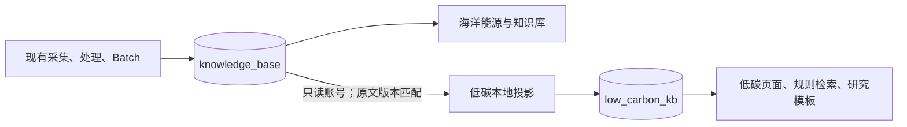

# 低碳子系统共享迁移与上线验收

日期：2026-10-25（北京时间）

> 上线状态：低碳电脑端已启用，健康检查返回 200。主知识库继续运行，海洋与低碳研究网页按需互斥运行；原采集、处理、共享数据和 Batch 后台继续运行。本次以电脑访问为交付范围，不继续扩展手机版适配。

## 交付范围

将 `knowledge-base-1018-v01` 的低碳六领域、术语规则、国别字典、展示配置和研究模板按功能合入当前项目。继续使用现网降本修复、统一采集与 Batch 处理；没有导入旧低碳数据库。低碳端使用统一资料的本地投影。

- 知识库：<http://49.233.77.111/>
- 海洋能源：<http://49.233.77.111/ocean-intelligence/>
- 低碳研究：<http://49.233.77.111/low-carbon/>
- 低碳来源状态：<http://49.233.77.111/low-carbon/source-management.html>

沿用现有访问密码。三个入口均已提供右上角“海洋能源 / 低碳研究”按钮，分别保存最近页面、领域筛选和研究草稿。访问暂停的研究系统会进入切换页；切换先停止另一研究网页，再启动目标网页，一般需要数秒至数十秒。主知识库不随切换停止。

## 共享与隔离边界

统一采集器、模型策略、任务频率、原有处理及 Batch 队列均保持原配置。适配器读取原始文章、公众号与 X 资料、已有海洋资料、证据正文和已完成的通用处理结果，因此不限于已通过海洋分类的文章。低碳六领域重新按本地规则计算，海洋分类和海洋研究结论不作为低碳结论。

后台每五分钟检查共享资料变化；页面“刷新”仅提交低碳本地更新标记。30 秒轻量检查器只检查本库的待办和到期时间，到期后才扫描来源库；投影程序处理完成即退出。每批最多 100 条，正文内部按 5 条读取，来源库连接池上限 1、单条查询超时 3 秒。源索引使用小型字段和版本缓存，避免反复读取整库 HTML。

按来源和原文内容版本匹配译文、摘要、提取和图片结果。原文变化不会套用旧结果。已准备的结果支持重试和去重，成功发布后才推进同步游标；删除资料退出当前低碳视图，历史正文版本和人工修订保留。共享源的普通新增和更新照常继续，不回写或覆盖原站文章。

## 大模型费用边界

低碳进程不注入模型 Key，不创建模型客户端，不启动独立采集器、供应商网关或 Batch 执行器。配置含模型 Key、模型网关或付费调度开关时，启动校验拒绝运行。低碳程序仅允许访问本机地址，不能访问外部模型供应商。

低碳来源账号 `lc_source_reader` 对原库只有指定表的 SELECT 权限，默认只读并设置查询超时；没有原模型请求表或原分类队列的写权限。网页进程不持有该来源账号，只访问自己的库。低碳应用账号 `lc_app` 写入 `low_carbon_kb`，启动校验数据库、角色、数据目录和实例标识；误连原库退出。

缓存缺失、失败或处理中均不补调模型。低碳翻译、识图和模型资源接口缺少可复用结果时返回明确的不可用状态；来源配置变更和共享处理任务入口由后端拒绝。前端相应隐藏付费生成按钮。原模型 Key、模型价格策略和 Batch 配置没有因本次迁移变更。

**验收口径：相同采集输入和现有系统操作下，低碳操作的新增模型请求、输入 Token、输出 Token 均为 0。** 原系统自身的正常付费任务仍可能继续产生费用。

## 功能变化

| 功能 | 低碳行为与影响 |
| --- | --- |
| 六领域分类、重新筛选 | 本地六领域规则；只更改低碳规则和投影，不修改原站分类。 |
| 阅读、摘要、翻译 | 复用匹配版本的已有结果；无译文时保留原文并提示，不自动翻译。 |
| 实体、关系、指标、图谱 | 复用原文支持的通用结果并重新赋予低碳领域；缺失时用本地规则提取线索。为控制资源，本地线索提取使用正文前 12,000 字，页面明确标注；完整正文和全文检索仍可用。 |
| 循证问答 | 对完整的本地正文进行关键词检索，返回原文摘录和来源；不调用向量模型或生成模型。 |
| 六领域简报、研究报告 | 本地摘录和研究模板，标注生成方法。可保存与导出，不提供额外模型推断。 |
| 方法推荐、量化、图表与计算 | 复用现有规则、研究工作台和计算引擎；公共数值保留来源、版本与单位，按低碳规则筛选。 |
| 扫描件、图片补录 | 有匹配的已有识别结果则复用；无结果时手工填写，不新增 OCR 模型任务。 |
| 来源管理 | 低碳端只读展示统一来源及状态；配置仍在现有管理入口维护。刷新只更新本地投影。 |
| 原知识库、海洋能源、降本与 Batch | 业务逻辑和数据保持现状；页面增加子系统切换入口。 |

## 部署方式与资源

同一 PostgreSQL 实例新增 `low_carbon_kb`，未新增数据库服务。程序在 `/opt/low-carbon/releases/20261025-shared-v1`，`/opt/low-carbon/current` 指向当前版本；独立数据位于 `/opt/low-carbon/data`。

- `low-carbon-app.service`：网页及低碳 API，监听本机 3201。
- `low-carbon-projector.service` / `.timer`：本地资料投影；完成即退出，避免空闲时常驻整库。
- `low-carbon.slice`：两进程合计 CPU 为单核 20%，内存上限 640 MiB。
- `/low-carbon/api/`：与海洋 API 分开；相对接口和过去固定 `/api/` 的管理接口均按系统解析。
- 低碳系统只允许写自己的数据目录；原站程序、环境文件和处理目录对低碳服务不可见。
- 限制大对象缓存，保留快照版本标记，低碳大型网页请求依次执行，避免并发整库副本挤占内存；普通静态页面、健康与会话检查独立响应。

主站已使用现网代码构建并发布切换入口及受认证的切换接口，13 个私有运行时配置与原版一致，旧静态资源保留。海洋网页按现网版本打最小补丁，没有整体覆盖为旧低碳版本。

互斥切换由 `/opt/knowledge-base/deploy/switch-research-subsystem.py` 控制，固定允许两个系统名，带锁、健康检查和失败回退；有未完成的交互简报时拒绝切换。原海洋每日简报移到 `research-period-reports.timer`，沿用原请求标识和去重规则，网页内对应调度停用，避免暂停海洋网页后漏执行或重复执行。原采集、处理、Batch 工作进程不随切换重启。

当前低碳启用、海洋网页暂停。保留原开机恢复行为，整机重启后默认海洋网页；可通过右上角切回低碳。

## 验证记录

### 已完成的验证

- Node 回归：497 项，494 项通过、0 失败，3 项按原配置跳过。覆盖降本、Batch、分类、问答、研究、导出、源版本校验、本地简报及共享模式防付费规则。互斥控制器另有 5 项 Python 测试通过。
- 固定输入回放：既有模型请求的内容和次数一致；新增输入 Token、输出 Token 均为 0。覆盖缓存缺失、重复刷新、本地问答和本地简报。该回放使用受控供应商响应，不产生真实模型费用。
- 云端操作：本地问答返回 8 个来源；缺失译文、识图返回 409；来源新增被拒绝为 403；重复刷新返回 202，数据池读取成功。
- 六领域简报：近 7 天 179 篇符合条件的文章，本地生成并成功发布，六个领域均为 `extractive`，无模型客户端。保留一份上线简报，清理本次带验收标记的重复研究。
- 费用观测窗口：云端模型请求账本数量 265 → 265，没有新增请求。同期既有异步任务补记了输入 2,686、输出 1,383 Token，且其请求内容状态发生更新；因此这段墙钟时间的累计 Token 变化不能用作低碳增量费用的直接证据。零增量判断同时依据固定回放、无 Key、后端拒绝付费任务、数据库权限和出网限制。
- 电脑浏览器：8 个页面模块加载通过。主站→低碳→主站及海洋→低碳实际往返切换通过，登录延续、深层筛选和研究草稿隔离通过；无页面脚本错误，无错误系统 API 请求。停止阶段两个在途请求按设计返回 409。
- 最新完整同步审计：共享缓存 13,260 条，低碳资料 2,090 篇，状态 completed、modelCalls 为 0。包括 169 篇被海洋规则排除但被低碳规则纳入的资料。资料会随统一采集继续变化。
- 数据隔离：来源角色只有 SELECT，不能更新原文章或写入模型请求表；应用不持有来源库凭据；低碳模型账本不存在、语义付费队列为空。
- 原站保护：停止低碳并重新启用海洋后，主站及海洋均正常；恢复后的环境、降本及处理配置哈希均未改变，原处理进程和 Batch timer 启动标识保持一致。
- 资源：元数据冷读约 8.3 秒。此前一轮 slice 峰值约 566 MiB；最后复查发现资料版本刷新时 224 MiB 的网页 V8 堆限制不足，出现一次堆内存溢出，已将网页堆调整为 320 MiB，保留整体 640 MiB 限制。调整后重新进行电脑端数据及简报加载检查，不把此前的短时健康检查当作长期稳定性证明。

### 部署期间的连接中断与最终状态

约 19:32 出现 SSH 握手超时、原站 HTTP 无响应，腾讯云控制台显示实例重启中，约 19:50 恢复连接。确切中断原因尚未确认；没有由本次部署执行整机重启，也没有用旧备份覆盖业务数据库。

恢复后先拉起原海洋网页，再完成互斥切换、主站入口发布及上述验证。当前低碳网页和投影 timer 已启用，海洋网页暂停；主站、共享数据、原处理、Batch timer 和原每日简报 timer 均正常。

验证明细见同目录 `low-carbon-shared-audit-2026-10-25/`。`final-audit.json` 为 20:26 海洋模式下的保护与隔离审计，`desktop-final.json` 为最终启用低碳后的电脑端检查。

## 回滚方法

本次原网页备份：`/opt/knowledge-base/low-carbon-backups/20261025-shared/`。

1. 日常回退只需右上角切回海洋，或执行 `python3 /opt/knowledge-base/deploy/switch-research-subsystem.py ocean`；主站和后台不停止。
2. 撤销全部补丁时，先阻止新切换，停止低碳 timer、投影及网页。确认独立每日简报无运行任务，再停用 `research-period-reports.timer`；保留两个数据库及数据目录。
3. 从备份的 `mutual-activation/` 恢复 `output.before`、`layout.before`、`marine-server.before`、`marine-app.before` 和原 period-reports、period-scheduler 模块；移除 `.data/period-schedule-external` 标记，使原海洋内置调度恢复，避免新旧调度同时运行。
4. 恢复备份的 Nginx 配置与原路由，执行 `nginx -t` 后 reload；只重启主站和海洋网页，检查原独立处理及 Batch 服务。

**不恢复旧数据库备份，不覆盖原业务库，不删除上线后新增的数据。** 单独停止低碳服务也不影响原站运行。
