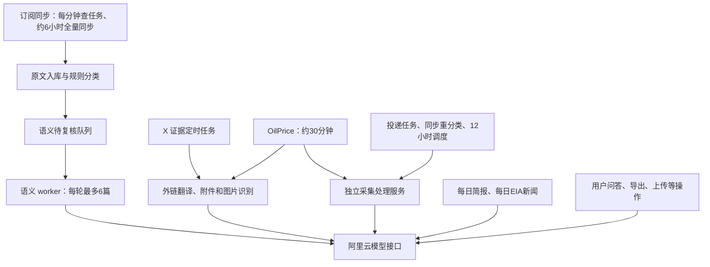

# 腾讯云部署、大模型调用与费用控制审计报告

审计日期：2026-10-25，北京时间。\
服务器：`49.233.77.111`，主机名 `VM-0-17-opencloudos`。\
本地项目：`/Users/guangyi/Code/other/knowledge-base`。\
本地分支：`ocean-strategic-intelligence`，提交 `e758e937c2ec3d4ed852374383a694a24f223aeb`。\
现场状态采样：约 14:34—14:39；日志统计固定截止于 **14:38:00**。

本次实际登录了服务器，读取了部署文件、进程环境、systemd 配置、运行日志和 PostgreSQL 统计，并核对了线上与本地代码。数据库查询使用只读连接；应用接口仅读取认证状态、健康状态和任务状态。**没有触发模型、向量、图片识别或联网搜索请求，也没有修改线上服务、密钥、数据库业务数据或调度配置。** 报告里的整改命令均未执行。

## 1. 先回答最关心的问题

| 问题 | 核验结论 |
| --- | --- |
| 什么时候调用大模型？ | 新文章语义复核、X 外链/图片处理、OilPrice 证据处理、智库采集后的抽取和翻译、每日简报会在后台调用；问答、摘要导出、向量化、上传识别、公众号发现等由用户操作触发。 |
| 是不是定时任务？ | **相当一部分是。** 本机既有 systemd 定时器，也有 Node 进程内部的调度器。不是只有人在页面提问时才调用。 |
| 一定需要调用吗？ | 原文采集、入库、规则分类、已有资料阅读、普通列表和统计不需要。自动翻译、语义复核、模型问答、图片识别等需要模型才能保持当前智能效果；部分入口可以降级成原文或规则结果。 |
| API Key 怎么管理？ | 多个功能共用同一把阿里云 Key，明文放在受权限保护的环境文件和进程环境里，PM2 持久化文件也保存副本。尚未按后台任务、人工操作分别隔离密钥和预算。 |
| 为什么没人操作也可能消耗？ | 后台自动任务仍启用；还存在超时后的重试状态遗漏，以及没有最大次数的语义失败重试。仅调低定时频率，不能解决这些问题。 |
| 怎么避免持续自动扣费，又保留功能？ | 先修复无效重试，保留正常调用；再把自动与人工调用分开管理、设置应用预算和云端预算。若要求无人操作时模型增量费用为零，需要暂停自动 AI，接受自动智能结果不再更新，或改成用户按需生成。 |
| 腾讯云目前是否已经停掉自动 AI？ | **没有。** 现场自动 AI 开关、证据任务、语义复核、OilPrice、EIA 新闻和每日简报调度仍在启用。 |

费用归属也要分清：**程序运行在腾讯云，但本项目当前模型请求发往阿里云百炼/MaaS。** `OPENAI_API_KEY` 是兼容接口的变量名，不代表模型费用交给 OpenAI 或腾讯云。

## 2. 腾讯云服务器的实际部署

### 2.1 主要组件和数据路径

| 组件 | 实际运行方式与位置 | 现场状态 | 与模型的关系 |
| --- | --- | --- | --- |
| 主知识库 | PM2 `knowledge-base`；`/opt/knowledge-base/.output/server/index.mjs`；3000 端口 | 在线 | 问答、分类、摘要、导出、向量化等使用 Nuxt 私有配置调用模型。 |
| 海洋智库网站 | PM2 `ocean-intelligence`；`/opt/ocean-intelligence/current/intelligence/run.mjs`；3101 端口 | 在线，`INTEL_ENABLE_AI=true`、`INTEL_SCHEDULE=true` | 网站交互和每日简报仍会调用；重处理转发给独立处理服务。 |
| 工作区数据服务 | PM2 `ocean-workspace-data`；3104 端口 | 在线 | 为工作区供数；未发现该服务直接调用模型。 |
| 独立处理服务 | systemd `ocean-processing.service`；`intelligence/processing-service.mjs`；3105 端口 | 运行中；自动调度和 AI 均启用 | 承担采集处理、抽取、翻译、向量和人工处理工作台。 |
| PostgreSQL | 本机 5432，仅监听回环地址 | 运行中 | 保存文章、语义队列、证据状态、工作区等。 |
| Nginx | 80 端口 | 运行中 | `/` 转到 3000；`/ocean-intelligence/` 转到 3101；智库 `/api/data` 单独转到 3104。 |
| 旧的界面测试进程 | 3102 端口；命令含 `/tmp/ui-stage-run.mjs` | 进程仍在；该脚本文件已经不存在 | 只读状态显示 `modelReady=true`，采集调度 `enabled=false`。不能仅凭它仍运行就认定它在自动调用模型。 |

3102 测试进程没有列在本次读取的根用户 PM2 清单中；当前 Nginx 的 `/haijian-preview/` 是静态目录配置，也没有发现其转发到 3102。建议后续整理其归属，但本次没有停止它。

实际发布目录为：

```text
/opt/knowledge-base/mp2rss-current
  -> /opt/knowledge-base/mp2rss-releases/20261011

/opt/ocean-intelligence/current
  -> /opt/ocean-intelligence/releases/country-assessments-20261018T121120Z
```

目录名称不是代码版本的充分证据：这些目录内有后续更新的文件。本次取回 27 个关键源码文件核对；部分哈希差异只是换行格式，实际逻辑差异主要包括智库网站的低碳分支、语义分类实现等。报告以线上配置和实际部署代码为准，本地代码定位见文末。

本地还有低碳子系统和共享模型网关代码；本次进程、端口和服务检查没有发现独立低碳服务或 3270 共享网关在运行，因此没有把这些尚未观察到部署的代码计入当前自动调用来源。

### 2.2 资源和服务健康

14:35 左右的主机快照：

- 系统为 OpenCloudOS，内核 `6.6.119-49.22.oc9.x86_64`，已运行约 141 天。
- 内存约 7.4 GiB，已用约 3.9 GiB，可用约 3.5 GiB，没有 Swap。
- 根磁盘约 180 GiB，已用约 72 GiB，使用率 40%。
- 主站首页和智库健康接口返回 HTTP 200；这些检查没有验证模型上游是否可用。
- 智库正式站和 3102 测试进程均报告 `modelReady=true`。**该字段表示本地已创建客户端，不代表 Key 权限、额度或上游调用已经通过验证。**

另有一个明确的运维问题：`ocean-research-publish.service` 反复失败，日志包含 `JavaScript heap out of memory`，退出状态为 134。它约每分钟重新被调度一次，可能占用 CPU 和内存。已检查的发布入口不调用模型，所以它不是直接的模型计费入口；应单独处理发布任务的内存问题，不能将它与模型重试混为一谈。

### 2.3 当前业务数据快照

以下是运行期间的瞬时统计，不同表不是同一个业务口径：

| 数据 | 现场读数 | 含义 |
| --- | ---: | --- |
| 主文章表 `public.articles` | 11,054 | 主知识库文章总量。 |
| 其中已纳入 | 1,617 | `filter_status='accepted'`。 |
| 标记已向量化 | 397 | 主知识库的向量化标记；不是智库全部资料的向量覆盖率。 |
| 订阅：启用且当前存在 | 100 | `enabled=true AND present=true`。 |
| 订阅：启用但当前不存在 | 53 | 仍有历史记录，不等于正在采集 153 个来源。 |
| 证据链接总量 | 9,097 | 包括图片、正文外链、附件等。 |
| 到期证据链接 | 351 | 全表到期数；还需按启用来源筛选，不等于全部立即执行。 |
| 到期超过一天 | 71 | 表明仍有积压。 |
| 证据正文 | 1,816 | `mp2rss.evidence_documents`。 |
| 其中已有中文正文 | 1,704 | 现有译文已保存，暂停生成不会删除这些译文。 |

独立处理状态文件在 14:36 显示：12 小时采集正在运行，14:28 左右启动，当时执行到 `expanded-sources.mjs`；上一轮完整采集完成时间为 **10 月 25 日 02:27:45**。文件里的 `nextRun` 仍是本轮的计划时间，不能把这个过去时间理解为又有一轮新的任务排队。

## 3. 调度和模型调用是怎样串起来的



这里有两个容易混淆的概念：

1. **任务被定时唤醒，不等于每次唤醒都调用模型。** 语义队列为空时只查数据库；同步任务没有新工作时也可以空跑。
2. **一个入口自己不直接调用模型，不等于它不会间接触发模型。** OilPrice 和订阅重分类都可能请求后面的处理服务。

### 3.1 当前启用的自动任务

| 自动任务 | 线上实际频率 | 调模型条件 | 是否受统一 AI 开关控制 |
| --- | --- | --- | --- |
| `mp2rss-evidence.timer` | 上次服务结束后约 1 分钟；单轮程序预算 5 分钟、systemd 超时 6 分钟 | 有到期证据需要英文翻译、帖子翻译或图片识别 | 读取 `INTEL_ENABLE_AI`；图片还要求 `MP2_VISION_MODEL`。 |
| `mp2rss-semantic.timer` | 上次结束后约 30 秒；每轮最多 6 篇 | 有到期 `pending/failed` 语义队列，且缓存未命中 | **该队列调用路径没有检查 `INTEL_ENABLE_AI`。** |
| `mp2rss-sync.timer` | 每分钟检查；自动全量同步约 6 小时一次 | 同步本身主要是采集和规则分类；重分类结果可能调用 `deliver()` | 间接处理请求受 `MP2_TRIGGER_INTELLIGENCE` 控制。 |
| `mp2rss-delivery.timer` | **实际为 12 小时** | 有持久化投递标记，且 `MP2_TRIGGER_INTELLIGENCE=true` | 请求 `/api/process`，后续是否调模型取决于处理服务。 |
| `ocean-processing` 内部调度 | 完整采集完成后约 12 小时再排下一轮 | 新资料或尚未完成的抽取、翻译、向量任务 | 处理服务自己的 `INTEL_ENABLE_AI`；内部定时受自己的 `INTEL_SCHEDULE` 控制。 |
| `oilprice-sync.timer` | 上次完成后约 30 分钟 | 除 RSS 发现外，还执行两轮证据处理，并尝试请求智库 `/api/process` | 证据阶段读取 AI 开关；处理请求**没有使用 `MP2_TRIGGER_INTELLIGENCE` 作为开关**。 |
| `ocean-eia-news.timer` | 每天 07:25，北京时间 | 有新的 EIA 相关文章 | 线上 shell 设置 `EIA_NEWS_AI=true`；采集器看这个开关。 |
| 网站内的每日周期简报 | 每 30 秒检查，每个北京日创建一份近 7 日简报 | 当天尚无对应任务，各领域有可用正文 | 网站进程 `INTEL_SCHEDULE`；模型客户端还依赖网站的 AI 配置。 |
| `ocean-eia-daily.timer` | 每天 07:10 | 更新 EIA 官方统计序列 | 已检查入口不调用对话模型。 |
| `ocean-research-publish.timer` | 约每分钟 | 发布已提交工作区和研究档案 | 已检查入口不调用模型；当前有内存失败。 |
| `ocean-snapshot-dedup.timer` | 约每 5 分钟 | 整理历史快照 | 不属于模型调用入口。 |
| 主站抓取调度插件 | 每分钟检查数据库中的抓取日程 | 有启用且匹配时间的抓取源 | 执行现成浏览器步骤；本次数据库未查到启用的抓取日程。 |

`mp2rss-delivery.timer` 的基础文件写的是 5 分钟，但线上有覆盖文件：

```text
/etc/systemd/system/mp2rss-delivery.timer.d/cadence.conf
OnActiveSec=12h
OnUnitInactiveSec=12h
```

因此只读仓库里的 `.timer` 文件会误判实际频率。根用户 crontab 中只看到了腾讯云管理代理的任务，没有看到本项目直接调用模型的 cron；主要调度逻辑在上表的 systemd 和 Node 进程里。

### 3.2 外链证据：何时调用、一次会调用多少

入口是 `scripts/mp2rss-worker.mjs evidence`，实现为 `server/integrations/x-evidence-store.mjs`。

一轮最多尝试 20 个工作项，同时受 5 分钟时间预算限制。这里的“20 个工作项”**不是 20 次模型请求的硬上限**：一篇长文可能需要多个翻译分段。

具体逻辑：

- 中文资料直接保留，不为了翻译而调用模型。
- 英文正文每约 6,000 字符调用一次 `qwen-plus`，输出上限 `max_tokens=10000`。
- 成功的翻译片段写入 `mp2rss.state`，按 URL、正文、模型、片段位置建立检查点。
- 图片在配置 `MP2_VISION_MODEL=qwen3-vl-plus` 时进入视觉模型，输出上限 3,500 token。
- 同一图片内容哈希不变、已有 `model_candidate` 时会复用结果；不是每次定时唤醒都重新识别图片。
- 已取得的正文、原文链接、译文和图片结果会保留在数据库，不依赖模型一直在线才能阅读。

**必要性判断：** 下载、HTML/PDF 解析和规则分类本身不需要模型；中文翻译与模型图表说明需要。暂停 AI 后原文仍可用，但新资料不再自动获得同样的中文和视觉解释。

### 3.3 语义复核：不是所有文章都必须调用

先进行规则分类，规则不能确定且有正文的文章才进入语义队列。人工标注、过期或输入版本已经变化的记录会被跳过；已有匹配的语义缓存也会跳过实际模型调用。

模型输入最多约 32,000 字符正文，加规则和领域定义；输出上限 1,600 token。每轮最多处理 6 篇，失败后固定延后 10 分钟。

现场队列为：

| 状态 | 数量 | 解释 |
| --- | ---: | --- |
| `completed` | 3,225 | 已有完成结果。最近 24 小时更新完成 267 条，最近 72 小时 749 条。 |
| `stale` | 3,180 | 输入、规则或当前文章状态发生变化，旧任务失效。 |
| `failed` | **52** | 仍会按到期时间重试；现场其中一批已有任务到期。 |
| `expired` | 10 | 按文章日期规则不再复核。 |

52 条失败记录上的累计失败尝试计数合计约 **2,954**，单条最高 **83**。这是记录累积值，不是“过去 24 小时收费次数”。目前没有最大重试次数或按错误类型停止的分支。

**必要性判断：** 关键词分类和人工分类不依赖模型。停语义 worker 后，模糊文章留在待复核状态，不会影响已经分类的文章阅读；但自动分类覆盖率会受影响。

**开关特别说明：** `semanticDecision()` 直接用 `OPENAI_API_KEY` 创建客户端；`mp2rss-worker.mjs semantic` 直接调用队列处理器。该路径没有检查 `INTEL_ENABLE_AI`。所以将 `mp2rss.env` 中这个值改成 `false`，**不能视为已经关停语义调用**。

### 3.4 采集和处理：12 小时只是完整采集的节奏

独立处理服务读取：

```text
/opt/knowledge-base/.env
    ↓ 再加载，后者可覆盖前者
/opt/ocean-intelligence/processing.env
```

完整采集会依次执行订阅导入、分类对账、新闻采集、官方和扩展来源、开放数据等步骤，再执行 `pipeline-worker.mjs`。有些步骤不需要模型，模型主要集中在：

| 处理阶段 | 模型行为 | 当前调度传入的边界 |
| --- | --- | --- |
| `collect.mjs` | 新资料相关性判断、标题摘要和事实抽取；另尝试生成向量 | 每个来源最多 4 篇，而不是全轮共 4 篇。 |
| `auto-extract.mjs` | 抽实体、事件、关系、指标；长文按块处理 | 每轮最多 6 篇；每篇可能多次调用，单次输出最多 6,500 token。 |
| `enrich.mjs` | 英文全文分段翻译；缺失向量时生成向量 | 调度传入每轮 6 篇；翻译约每 3,500 字符一段，输出最多 10,000 token。 |
| `enrich-evidence.mjs` | 翻译缺失的原文证据摘录 | 调度传入最多 6 篇；每组最多 8 条摘录。 |

已有抽取、翻译和文章检查点能减少重复开销，但这些上限仍然是“篇数/时间”，不是人民币预算。

**完整采集每 12 小时一次，不代表所有处理每 12 小时最多一次。** 以下入口还会请求只处理、不重新采集的流水线：

- `mp2rss-delivery` 的投递请求。
- 订阅同步发现重分类后的 `deliver()` 请求。
- OilPrice worker 的 `/api/process` 请求。
- 用户在网页上手动发起的处理请求。

正式网站设置了 `INTEL_PROCESSING_REMOTE=true`，这些工作转到 3105。只重启网站或只关闭网站 AI，不能关闭处理服务中的模型调用。

### 3.5 OilPrice：RSS 发现本身不调模型，后续处理会调

`scripts/oilprice-worker.mjs` 的实际顺序是：

1. 发现 RSS 中的新链接。
2. 调用 `processXEvidence({provider:'OilPrice RSS', deadline})`，处理正文翻译等工作。
3. 时间允许时再调用一次，处理上一遍发现的图片和附件。
4. 登录本机智库并请求 `/api/process`。

证据处理共享最长约 20 分钟的截止时间。**不能把 `oilprice-sync.timer` 归为“纯 RSS、不会调用模型”的任务。** 过去固定 24 小时内，它的日志确实记录了 **14 次进入模型阶段**，分布在 9 次服务执行中。

同时，停掉 `mp2rss-evidence.timer` 只会停 X 的常规定时证据入口，**OilPrice 的这条独立入口仍可执行同一个证据处理函数**。

### 3.6 EIA：官方统计和新闻是两套任务

- **07:10 的 EIA 统计任务**运行官方序列导入，不需要用对话模型更新统计值。10 月 25 日这次服务退出成功。
- **07:25 的 EIA 新闻任务**在 `/opt/ocean-intelligence/eia-news-daily.sh` 中设置 `EIA_NEWS_AI=true`，采集到新文章后可调用 `qwen-plus` 生成中文和事实候选。10 月 25 日 07:27 左右完成，日志为新文章 0、错误 0，因此这一次成功不能作为“本次已调用模型”的证据。

线上新闻脚本当前只运行 `collect-eia-news.mjs` 和 `publish-eia-news.mjs`。仓库中另有带 `process-eia-news.mjs` 的流水线脚本，**该脚本里的额外处理步骤不能直接算作当前线上每天都在执行的步骤**。

### 3.7 每日简报：确实自动调用，但已有幂等保护

网站 `createPeriodScheduler()` 每 30 秒检查一次，以 `daily-weekly-北京日期` 为持久化请求标识，每天创建一份近 7 日简报；重启后会检查是否需要补建，不要求有人打开页面。

- 每个有正文资料的领域调用一次模型，最多 6 个领域。
- 同一个日任务不会因为定时检查而反复重新创建。
- 模型失败时改用原文摘录，当前代码不自动重试这次模型调用。
- 已有任务与发布结果存到文件，读取页面不会再生成一遍。

现场看到 **10 月 25 日 00:03:12 已发布当天简报**，其中 5 个领域记录 `summaryMethod='model'` 和模型请求 ID，另一个领域无足够资料。说明至少在这个时刻，自动简报真实取得了模型结果。

费用风险在于输入量：当前没有每领域文章篇数硬上限，会把领域内全部合格文章的截取正文组合成输入。当天其中一个领域有 120 篇输入，另一个有 68 篇。**“每天只调用几次”不等于每天只花很少 token；`max_tokens=4000` 只限制输出，不限制输入。**

## 4. 哪些操作是人点击后才调用

| 功能 | 调用方式 | 模型不可用时的实际影响 |
| --- | --- | --- |
| 主知识库问答 `/api/qa` | 先生成问题向量，再检索，再调用对话模型 | 这条路径直接依赖向量和对话接口，没有与智库相同的完整检索降级路径。 |
| 智库问答 `/api/ask` | 尝试向量检索，再用 `qwen-plus` 回答 | 有关键词检索和资料摘录降级；可阅读检索结果，但不再是完整模型综合回答。 |
| 主站文章分类、筛选试跑 | 规则匹配不确定时调用模型 | 规则结果仍可用，语义判断可能保留为待处理。 |
| 导入时选择自动分类 | 导入请求结束前执行分类 | 虽然不是定时器，单次请求可能处理很多历史待分类文章。 |
| 文章摘要、Markdown/Word 摘要导出 | 对缺少合适摘要的文章逐篇调用 | 多个导出实现有原文/摘要降级；模型精炼效果受影响。 |
| 手动邮件推送 | 先生成 Word 附件，间接生成文章摘要 | 发送动作本身不等于模型动作；附件摘要可能调用。此次未发送邮件。 |
| 日期范围/批量向量化 | 文章拆块，每 6 段一批请求 embedding | 向量索引不再新增；已有向量不会消失。 |
| 图表生成 | 流式对话模型 | 新的模型图表生成不可用。普通已有图表展示不因此失效。 |
| 抓取步骤 AI 生成 | 根据页面结构调用模型生成浏览器步骤 | 已保存的抓取步骤仍能执行，新的 AI 步骤生成受影响。 |
| 智库上传文件、图片 OCR、事件抽取 | 图片用视觉模型，结构化提取用文本模型 | 文本读取和人工填写仍可用的部分保留；OCR 和自动提取需要模型。 |
| 人工处理工作台 | 请求独立处理服务，执行语义复核和事实抽取 | 处理服务关闭 AI 后，该工作台不能保证保持原功能。 |
| 研究方法建议、对象资料识别 | 文本模型，部分功能有每 IP 每小时次数限制 | 手动选择研究方法等基础操作保留，自动建议/识别受影响。 |
| 公众号发现 | 百炼原生接口，显式开启联网搜索 | 自动查找候选链接需要模型与搜索；原有订阅的常规同步不因此必然停止。 |

这些入口没有发现对应的本机自动定时器，但一次操作也可能发出很多请求。两个具体的批量费用风险是：

1. `server/api/articles/import.post.ts` 的 `autoClassify` 查询只限定“全库 pending 且有正文”，**没有限定这一次新导入的文章 ID**。一次小批导入，可能触发对历史待分类文章的批量复核。
2. 多个导出函数会复用已有合适长度的摘要；但新生成的导出摘要没有在这些函数里统一回写成持久化缓存。反复导出同一批缺失摘要的文章，可能反复生成。

智库问答目前有每 IP 每小时 12 次限制，方法建议、上传等也有各自的次数限制；这些是内存中的入口限流，**不是覆盖全部系统的预算**。主站公共模型封装没有同等级别的统一预算入口。

## 5. 已确认的异常重试，以及它能证明什么

### 5.1 固定时间窗口统计

统计来自 systemd journal 中的结构化日志，截止 **2026-10-25 14:38:00 +08:00**：

| 证据任务指标 | 过去 24 小时 | 过去 72 小时 |
| --- | ---: | ---: |
| X 证据任务进入 `model` 阶段 | **2,713** | **5,288** |
| 包含模型阶段的 X 服务执行次数 | 294 | 579 |
| 日志中不同模型目标路径 | 832 | 1,966 |
| X 任务以 `deferred` 结束的批次 | 183 | 454 |
| 短链 `https://t.co/dfSdXWeMN8` 的模型阶段次数 | **846** | **1,735** |
| 涉及该短链的服务执行次数 | 99 | 199 |
| 其中以 `deferred` 结束 | 97 | 197 |
| OilPrice 任务进入模型阶段 | **14** | **178** |

需要遵守三个统计边界：

- `model` 日志在发请求之前写入；如果随后发现剩余预算不足，甚至可能还没发出网络请求。因此它是**模型阶段尝试指标，不是平台成功请求数或收费次数**。
- 同一长文的多个分段也会记多次，不能把同 URL 的所有次数都判作重复收费。但该短链横跨近百次服务执行且绝大多数以延期结束，结合下一节代码，可以确认存在重复调度问题。
- 日志只保留 URL 的域名和路径，去掉了查询参数。不同参数的图片可能归到同一个路径，不能用该统计精确计算独立图片数量。

本次没有读取阿里云实际账单，不能将 2,713 次乘一个单价，声称这就是已经扣走的金额。

### 5.2 外链任务的超时退避缺口

正常失败路径会把链接更新为 `retry`，并把 `next_check` 推后 6 小时。但实际代码先处理了另一个分支：

```javascript
catch (e) {
  if (e.code === 'BATCH_DEFERRED' || Date.now() >= deadline - 1000) {
    result.deferred = true;
    break;
  }
  // 只有走到这里，才更新 next_check 为 6 小时后
}
```

`boundedClient()` 又会在请求超时、整轮预算已经耗尽时，把错误转成 `BATCH_DEFERRED`。于是形成：

```text
链接已经到期
  → 开始下载/翻译
  → 本轮预算耗尽
  → 跳出，不更新该链接 next_check
  → 服务结束，约一分钟后再次启动
  → 同一链接仍然到期，再次进入处理
```

成功片段有缓存，但失败、响应不确定或未能保存的片段仍可能被重复尝试。5 分钟时间预算因此不能充当费用预算。

这条异常短链在本次读取时已经变为普通的 `http_403` 模型错误，最近处理时间 **10 月 25 日 12:28:30**，`next_check` 为 **18:28:30**。因此，**不能说它在 14:38 这个时点仍按分钟不断执行**；大量重复主要发生在统计窗口内较早的延期阶段。退避缺口在部署代码中仍未修复，其它超时任务仍可能进入相同路径。

### 5.3 语义队列没有失败上限

语义队列的失败路径统一处理为：

```text
status = failed
attempts = attempts + 1
next_retry_at = 当前时间 + 10分钟
```

它没有区分认证/权限/额度错误、临时限流、网络故障、输出校验错误，也没有“达到若干次后暂停”的分支。52 条失败记录、最高 83 次的现场计数，表明问题已经实际发生，而不只是理论风险。

更长的唤醒间隔只能降低尝试速度；如果不改变状态机，长时间运行仍会不断重试。

### 5.4 当前还出现了较多上游拒绝

证据链接最新失败状态中，**502 条记录**保存的是 `stage=model, code=http_403`。这是 502 条记录各自最近一次失败的类别，**不是 HTTP 502，也不是本次窗口内的失败请求总量**。

仅凭 403 无法确定是 Key 权限、特定模型权限、免费额度策略、账户状态，还是其它服务端限制。现有日志没有完整保留能定位这些原因的安全错误码。举例说，阿里云的“免费额度用完即停”也可能返回 HTTP 403，并带有 `AllocationQuota.FreeTierOnly`；本次没有取得该具体错误码，所以不能断言已经欠费或免费额度已经耗尽。[阿里云免费额度说明](https://help.aliyun.com/zh/model-studio/new-free-quota/)

**失败不等于已收费；超时也不等于一定没收费。** 应以平台用量和账单核实，不能根据本地错误状态倒推准确金额。

## 6. API Key 当前的管理方式

### 6.1 实际提供方与模型

```text
接口地址：
https://ws-hggqyc9hxqg2lnlu.cn-beijing.maas.aliyuncs.com/compatible-mode/v1

文本模型：qwen-plus
向量模型：text-embedding-v4
证据图片模型：qwen3-vl-plus
```

代码主要通过 OpenAI 兼容 SDK 或直接 HTTP 请求访问阿里云。向量请求也属于模型请求，不能只统计 `/chat/completions`。

公众号发现还调用百炼原生文本生成接口，携带 `enable_search=true` 和强制联网搜索参数。这个入口需要把搜索附加费用纳入核账，不能只看文本 token。

### 6.2 已核验的密钥来源和副本

本次在服务器内比较密钥指纹，确认下面活跃配置使用同一把 Key，报告统一称为 **Key-A**，不记录密钥内容。

| 位置 | 内容/用途 | 权限与现场结论 |
| --- | --- | --- |
| `/opt/knowledge-base/.env` | `OPENAI_API_KEY` 和 `NUXT_OPENAI_API_KEY` 均为 Key-A；主站和多数任务的基础配置 | `root`，`0600`。 |
| `/opt/knowledge-base/mp2rss.env` | AI、视觉模型、投递等覆盖配置 | `root`，`0600`；**当前文件本身没有模型 Key**，worker 从主 `.env` 读取。 |
| `/opt/ocean-intelligence/processing.env` | 独立处理服务的 Key-A、副本地址及 AI/调度开关 | `root`，`0600`；会覆盖该服务先加载的主 `.env`。 |
| `/opt/ocean-intelligence/eia.env` | EIA 官方数据接口配置 | `root`，`0600`；不是当前大模型 Key 的来源。 |
| PM2 管理的进程环境 | 主站和智库启动时带入的 Key-A | 内存里仍有副本，改配置文件不会自动改掉已经运行的客户端。 |
| `/root/.pm2/dump.pm2` 和 `.bak` | PM2 保存的进程启动环境，含 Key-A | 两个文件均为 `0644`；`/root` 权限为 `0550`，不能据文件权限直接说公网或任意本地用户可读，但建议文件收紧为 `0600`。 |
| `model-account-backup-*` 和 `.env.before-*` | 历史密钥/启动配置备份 | 已发现两个模型切换备份目录；目录 `0700`、其中配置/JSON `0600`。旧 Key 是否已撤销未核实。 |

当前属于**环境文件明文注入 + 进程环境 + 运维备份**，没有发现专门的密钥托管、动态轮换或按任务独立授权的实现。

积极的一面是：Nuxt 把模型 Key 放在服务端私有 `runtimeConfig`，没有配置进 `public`；本次精确扫描主站 `.output` 的 1,320 个可检查文件，没有找到当前活跃 Key 的原文。本地当前跟踪文本的常见 `sk-` 形式扫描也没有发现长密钥形态。**这不等于已经完成所有历史 Key、Git 历史和全部备份的泄漏审计。**

### 6.3 为什么更换一处 Key 可能仍然扣旧账号的钱

`scripts/switch-model-account.py` 当前会：

1. 验证新模型配置；这个验证脚本本身会真实调用接口。
2. 备份主 `.env`、`mp2rss.env`、`eia.env` 和 PM2 配置。
3. 修改主文件及其中已有的覆盖字段。
4. 重启 PM2 的 `knowledge-base` 和 `ocean-intelligence` 并保存环境。

它**没有把 `/opt/ocean-intelligence/processing.env` 纳入更新，也没有重启 `ocean-processing.service`**。因此只运行这个脚本，独立处理服务可能继续读旧 Key，向旧账号继续发请求。

还需同时核对：

- `OPENAI_API_KEY` 与 `NUXT_OPENAI_API_KEY` 是否一致；Nuxt 有独立的运行时覆盖变量。
- `.env`、systemd 的后续 `EnvironmentFile` 和 PM2 保存环境有没有互相覆盖。
- 常驻服务是否已经重启，新的短任务是否读到了新值。
- 旧的测试进程和历史备份是否仍引用旧配置。

只看“文件已改”，不足以证明所有活跃调用方已切换。

### 6.4 开关的有效范围

| 操作 | 能控制什么 | 覆盖不到什么 |
| --- | --- | --- |
| 将 `mp2rss.env` 的 `INTEL_ENABLE_AI=false` | X/OilPrice 证据函数内创建 AI 客户端的分支 | 语义队列当前不检查它；处理服务、EIA 新闻和网站各有配置。 |
| 将 `processing.env` 的 `INTEL_ENABLE_AI=false` 并重启处理服务 | 独立服务里的模型处理 | 主站问答、网站问答、每日简报、语义 worker、EIA 新闻等。且人工处理工作台也可能不可用。 |
| 将网站进程 `INTEL_SCHEDULE=false` 并重启 | 网站的自动每日简报；非远程模式下的内部采集调度 | 独立处理服务及 systemd 定时器。 |
| 将处理服务 `INTEL_SCHEDULE=false` | 处理服务自身的自动计时器 | 其它任务仍可请求 `/api/process`。 |
| 将 `MP2_TRIGGER_INTELLIGENCE=false` | mp2rss 的 `deliver()` | OilPrice worker 当前仍直接请求 `/api/process`。 |
| 清空 `MP2_VISION_MODEL` | 证据图片模型识别 | 文本翻译、语义、向量等。 |
| 停一个 `.timer` | 停该入口今后的定时启动 | 正在运行的 `.service`，以及其它调用同一函数的入口。 |
| 删除共享模型 Key | 最终阻止使用该 Key 的调用 | 同时会让正常人工智能功能失败；其它 Key 和按时长资源另算。 |

**目前没有一个已经验证可用的总开关，能做到“所有自动模型关闭，所有人工模型功能完整保留”。** 达到这个目标需要拆分调用策略，而不只是改一个变量。

## 7. 怎样控制费用，同时尽量保留现有能力

### 7.1 推荐方案：保留正常 AI，先消除无效重复

这是对正常业务影响最小的方向：正常新文章继续处理，人工问答和导出继续使用；让永久性失败和预算耗尽任务停止反复尝试。

具体改动应包括：

1. **修外链延期状态。** 即使因为 `BATCH_DEFERRED` 退出，也先持久化当前链接的 `next_check`、检查点和错误类别。不能让正在失败的项目一直停在到期队首。
2. **区分失败种类。** 权限/认证/明确额度耗尽进入暂停状态；网络和临时服务错误使用递增退避；数据格式和校验错误设有限重试。保存安全的服务端 `error.code`、请求 ID、模型和 HTTP 状态，避免保存凭据和完整请求头。
3. **限制单内容版本尝试次数。** 例如同一链接/片段每 24 小时最多一次新的自动尝试，累计若干次失败后转人工处理。具体数值应结合业务时效调整，而不是把它理解为已经存在的配置。
4. **为语义队列设置失败上限与错误分类。** 当前固定 10 分钟、无限累计需要改掉；认证故障期间应对该类模型统一暂停，而不是 52 篇各自反复试。
5. **补全幂等。** 按正文哈希、目标语言、模型和提示词版本复用翻译、摘要、抽取结果；将长文分段检查点保存到可恢复状态。模型超时后的结果不确定时，不立即无条件重发。
6. **限制实际输入和累计消耗。** 除每轮篇数外，增加单文档 token 预算、每日任务请求/输入/输出上限。每日简报按有效证据压缩输入；降低输出上限不能代替输入预算。

这些修复可以保留成功时的功能语义；达到预算或失败上限后的自动更新会延迟，不能承诺所有数据时效完全不变。

### 7.2 把后台预算与人工预算隔离

推荐至少拆成两个独立 Key 或业务空间：

| 调用类型 | 分配范围 | 预算耗尽时的行为 |
| --- | --- | --- |
| 人工 Key | 问答、手动导出、用户明确发起的识别/研究处理 | 给用户清晰状态，保留原文和已有结果。 |
| 自动 Key | 语义队列、X/OilPrice 证据、定时采集处理、EIA 新闻、每日简报 | 暂停新的自动模型请求，保留队列和原文采集，等待额度或人工恢复。 |

仅创建两把 Key 不会自动生效：现有自动与人工代码共享客户端，独立处理服务还同时服务人工工作台。需要在调用点根据 `trigger=manual/automatic` 选择凭据和预算，并把这个来源传递到子进程；不能把来源标签只留在网页层。

调用入口建议统一经过预算层，记录：任务类别、触发来源、文档/内容版本、模型、尝试次数、平台请求 ID、实际输入/输出 token、缓存命中、HTTP/错误码。**调用前预留预算，调用后结算**，并对响应不确定的调用保留预留额度，避免并发请求先花费、最后才发现超额。

目前部分人工处理日志会记录 `usage`，但没有贯穿全部文本、向量、视觉和原生搜索入口的统一账本。现有“每轮 5 分钟”“每轮 6 篇”“每小时 12 次”也不能相互替代。

### 7.3 使用阿里云预算功能作为第二层限制

截至审计日，百炼支持按账号、业务空间、API Key 设置月度预算，并可启用“达到预算后立即停止”。因此不应只设置提醒后继续放任调用。建议后台 Key 使用独立预算和停用策略，人工 Key 留独立额度，避免后台耗尽导致用户功能一起停。该机制有停止延迟，也不覆盖所有 PTU/DTU、训练等计费项；不能当作严格到分的实时限额。[阿里云预算管理](https://help.aliyun.com/zh/model-studio/budget-management)

本次没有登录百炼控制台，**无法确认当前账号是否已设置预算、免费额度用完即停或自动充值，也没有替用户变更这些设置**。具体人民币额度应由可接受的支出决定，不能根据本地日志凭空设定。

### 7.4 如果要求无人使用时不再新增模型费用

可以实现，但要把“后台采集”与“后台 AI”分开：

- 原文、RSS、数据库更新和关键词分类继续执行。
- 语义、翻译、图片识别、自动简报等只排队，不自动发模型请求。
- 用户点击生成时使用人工预算执行；已有中文、摘要、索引和简报照常读取。

**当前代码还不能靠一个开关实现上述模式。** 需要同时调整：

| 入口 | 为保留基础功能应做的调整 |
| --- | --- |
| 语义 worker | 增加明确的自动 AI 策略检查；关闭时保留队列。 |
| X/OilPrice 证据处理 | 将下载和入库与翻译/视觉阶段分离；关闭 AI 时不丢待识别状态。 |
| OilPrice `/api/process` | 增加与其它自动入口一致的策略参数，或仅请求不含模型的入库处理。 |
| mp2rss 投递与重分类 | 自动触发时携带策略；不能只停专门的 delivery 定时器。 |
| 独立处理服务 | 将自动模型与人工处理的客户端/开关分开；人工处理仍可用。 |
| EIA 新闻 | 允许规则采集继续，单独关闭 AI 提取。 |
| 每日简报 | 关闭自动创建；用户仍可手动生成。若希望自动生成纯摘录版，还需调整当前必须配置模型才能 `create()` 的前置检查。 |

这样可以保留页面、采集、已有结果和人工入口，但自动智能结果会变成按需更新。若要求自动翻译、自动语义、自动模型简报持续照常运行，就仍会有模型消耗。

## 8. 可以立即采用的临时止损操作及影响

**下面是供实施的操作说明，本次没有执行。** 如果先要压住已确认的两条异常重试入口，可停止对应定时器和正在运行的服务：

```bash
systemctl disable --now mp2rss-evidence.timer mp2rss-semantic.timer
systemctl stop mp2rss-evidence.service mp2rss-semantic.service
```

停止后的边界：

- X 常规自动证据处理、自动语义复核暂停，现有结果和原文保留。
- 主站问答、网站问答、导出和手动操作仍有原来的配置，没有因这些命令被关闭；上游已有的权限/额度问题不会因此自动修复。
- **这不是全系统自动模型停机。** OilPrice、独立处理服务、EIA 新闻和每日简报仍可能调用。
- 停止正在执行的服务可能中断当轮处理，恢复后应依赖已保存检查点，而不是假设当轮全部完成。

如果要进一步暂停某类自动能力，可按下表分别处理，不能声称它们都“功能完全不受影响”：

| 调整 | 可减少的自动调用 | 代价/遗漏 |
| --- | --- | --- |
| `processing.env` 关闭 AI，重启 `ocean-processing` | 独立处理的抽取、翻译、向量 | 人工处理工作台也依赖同一客户端，可能失效；其它独立 worker 不受控。 |
| 网站进程关闭 `INTEL_SCHEDULE` 并重启 | 每日自动简报 | 不再每日自动发布；人工模型仍可配置保留。 |
| 修改线上 EIA 新闻脚本的 `EIA_NEWS_AI=false` | EIA 新文章模型提取 | 保留规则和原文，中文智能结果减少。 |
| 停 `oilprice-sync.timer` 和对应 service | OilPrice 的证据和间接处理 | 连 RSS 发现也一起暂停，适合紧急措施，不是保留采集的长期方案。 |
| 仅将处理服务 `INTEL_SCHEDULE=false` | 内部周期采集 | 其它自动任务仍可请求 `/api/process`，不能保证停止自动 AI。 |

不要为省模型费用直接删除共享 Key 或停止整站；那会同时影响正常人工功能。也不要把停止 EIA 官方统计或历史快照整理当作主要的模型控费措施。

修复并完成验证之后，再恢复需要的任务：

```bash
systemctl enable --now mp2rss-evidence.timer mp2rss-semantic.timer
```

恢复前应核对原来的启用状态、当前队列、上游错误原因和新预算；这里不是建议立即恢复。

## 9. 实施优先级与验收标准

| 优先级 | 工作 | 完成标准 |
| --- | --- | --- |
| 最高 | 修证据 `BATCH_DEFERRED` 状态遗漏 | 一次延期后该任务不再立即到期；下一轮不会重复占据队首；已有分段继续复用。 |
| 最高 | 语义失败上限、认证/额度故障暂停 | 持久性失败不会每 10 分钟永久尝试；其它正常任务不被坏任务阻塞。 |
| 最高 | 查清已记录的模型 HTTP 403 | 取得安全错误码、模型和请求 ID，并在控制台确认权限/额度原因；不要以 `modelReady=true` 代替。 |
| 高 | 自动与人工 Key、策略、预算分离 | 自动预算耗尽只暂停自动模型；人工问答、导出、识别和处理工作台可独立使用。 |
| 高 | 覆盖 OilPrice、原生搜索、向量入口 | 所有入口都进统一策略层；不存在绕过预算的直连路径。 |
| 高 | 修正密钥切换脚本 | 更新所有有效环境源，重启对应常驻进程；用指纹验证各进程，不打印密钥。 |
| 中 | 统一摘要/翻译/抽取缓存 | 同一内容版本重复导出或重新调度，命中缓存而非重新调用。 |
| 中 | 修小批导入扫描全库的问题 | 自动分类只覆盖实际导入/明确选中的文章。 |
| 中 | 每日简报输入预算 | 保留领域覆盖，明确压缩/选取依据，输入不再随文章数无限增长。 |
| 中 | 修研究发布 OOM 和遗留测试进程 | 发布成功或有有限退避，不再约每分钟内存失败；测试进程有明确归属与生命周期。 |
| 中 | 收紧 PM2 副本、备份管理 | dump 文件权限合适；备份有保留期限和旧 Key 撤销记录，补充对应忽略规则。 |

验证时先使用模拟模型客户端和独立测试数据，覆盖超时、403、429、输入校验失败、进程中断和同一任务重复投递；不能为了检查控费功能，先对生产全库执行一次分类或翻译。

上线验收应同时观察至少一个正常调度周期：

- 没有用户操作时，各类自动调用符合已选策略和预算。
- 同一失败内容版本的尝试次数受到约束；到期时间、暂停原因和恢复方式可追踪。
- 手工问答、导出和识别只使用人工预算；自动预算耗尽时这些入口不被连带阻断。
- 原文采集继续，旧译文、已有向量、历史简报和文章阅读正常。
- 应用记录的 token/请求 ID 与百炼用量、账单能对上；响应不确定的调用单独核查。

这些是后续整改的验收要求，**本次完成的是审计与报告，没有声称上述整改已经上线**。

## 10. 账单层面能确认与尚不能确认的事项

### 已确认

- 服务器确实在无人点击时执行具备模型调用能力的任务，且历史日志/简报结果有实际调用证据。
- 外链延期退避和语义无限重试存在真实问题。
- 多个组件共用同一把阿里云 Key，目前本地不能按 Key 区分人工与自动费用。
- 现有日志指标不等于准确的已结算人民币金额。

### 需要云控制台才能确认

- 当前阿里云余额、冻结/预占金额、实际扣款、免费额度、各模型单价及资源包抵扣。
- 当前 Key 的月度预算、停用策略、权限范围，及是否还有别的应用使用同一账号或其它 Key。
- 是否存在按时长计费的模型专属部署、预置吞吐或其它资源。代码中的 MaaS 工作空间地址不能单独证明有没有这类付费资源。
- 腾讯云实例属于哪种产品、计费方式、续费日期、自动续费状态及云端账单。**服务器 root 账号是操作系统权限，不是腾讯云财务控制台的登录凭据。**

核账时应在百炼按地域、API Key ID、模型和日期筛选用量与费用；附加搜索等计费项单独核对。模型推理账单可能延迟，停止请求后看到余额变化也可能是先前调用出账；若有按时长资源，停止 API 请求还不等于停止那部分计费。腾讯云服务器、磁盘等费用需在腾讯云另行核账。[阿里云账单与成本管理](https://help.aliyun.com/zh/model-studio/bill-query-and-cost-management)

## 附录：关键代码和线上证据定位

下表行号以本地当前源码为准；线上主要行为已经另行核对，个别文件的导入项和行号存在差异。

| 关注点 | 本地源码位置 |
| --- | --- |
| Nuxt 私有配置、`NUXT_` 运行时对应字段 | `nuxt.config.ts:22` |
| 主站共享模型客户端、向量批处理、对话 | `server/utils/embedding.ts:5`、`:28`、`:72` |
| 主站规则优先、模型兜底分类 | `server/utils/classification.ts:160` |
| 导入自动分类扫描范围 | `server/api/articles/import.post.ts:61` |
| 导出摘要复用和生成 | `server/utils/docx-builder.ts:35`、`server/api/articles/export-summary.post.ts:32` |
| 外链翻译、AI 开关、到期队列、延期分支 | `server/integrations/x-evidence-store.mjs:22`、`:47`、`:93`、`:114` |
| 时间预算转换为 `BATCH_DEFERRED` | `server/integrations/evidence-budget.mjs:1`、`:12` |
| 语义模型客户端、队列、固定失败重试 | `intelligence/semantic-classification.mjs:29`、`:45`、`:72` |
| mp2rss 自动投递、语义调用入口 | `scripts/mp2rss-worker.mjs:6`、`:18` |
| OilPrice 两轮证据和处理请求 | `scripts/oilprice-worker.mjs:12` |
| 12 小时调度、子进程上限、步骤列表 | `intelligence/scheduler.mjs:22`、`:33`、`:55` |
| 独立处理客户端和工作台共用 | `intelligence/processing-service.mjs:31` |
| 网站 AI、每日简报、远程处理和问答 | `intelligence/server.mjs:54`、`:61`、`:78`、`:143` |
| 全文翻译、向量、检查点 | `intelligence/enrich.mjs:32` |
| 事实抽取和自身递增退避 | `intelligence/auto-extract.mjs:61` |
| EIA 新闻独立开关 | `intelligence/collect-eia-news.mjs:21` |
| 每日简报幂等与模型失败降级 | `intelligence/research/period-scheduler.mjs:4`、`period-reports.mjs:34`、`:45` |
| 密钥切换遗漏处理服务 | `scripts/switch-model-account.py:65`、`:104` |
| 公众号发现的原生联网搜索 | `server/integrations/mp-discovery.mjs:7` |

线上证据主要来自：

```text
systemctl list-timers --all
systemctl cat <对应 service/timer>（包括 drop-in 覆盖）
systemctl show <对应 service>
pm2 jlist（输出前仅提取必要元数据和密钥指纹）
/proc/<pid>/environ（仅提取必要配置和密钥指纹）
journalctl -u mp2rss-evidence.service
journalctl -u oilprice-sync.service
journalctl -u ocean-research-publish.service
/opt/ocean-intelligence/data/collection-status.json
/opt/ocean-intelligence/data/period-reports/runtime.json
classification.semantic_queue / semantic_cache
mp2rss.state / evidence_links / evidence_documents
public.articles / scrape_sources
```

报告未保存 root 密码、模型 API Key、站点密码或数据库连接密码。
